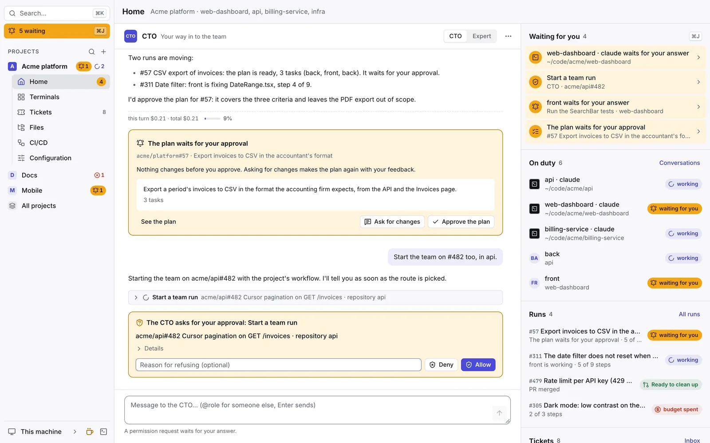
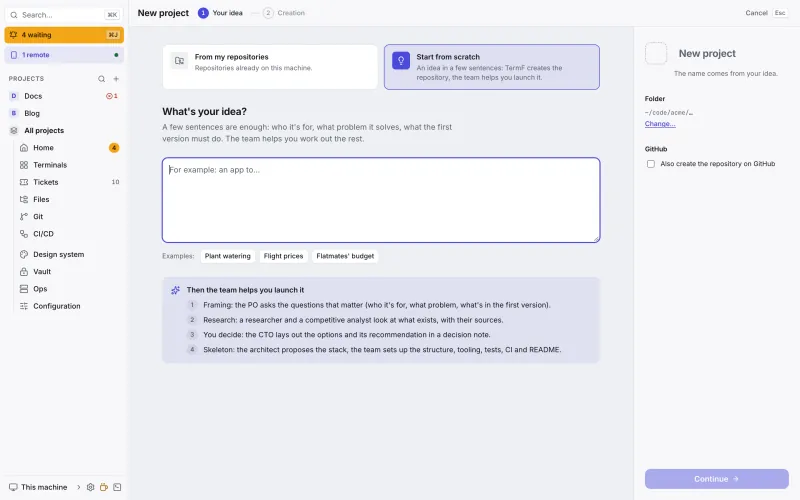
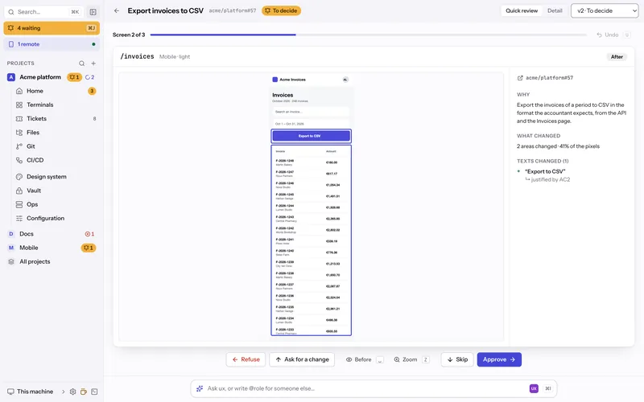
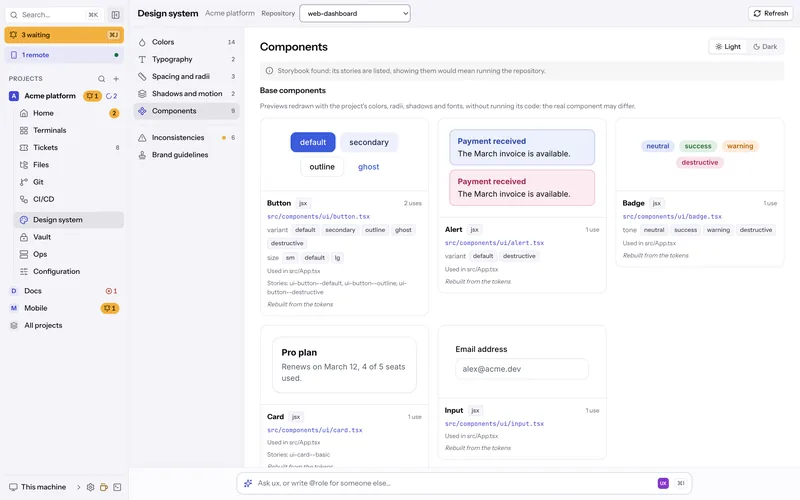
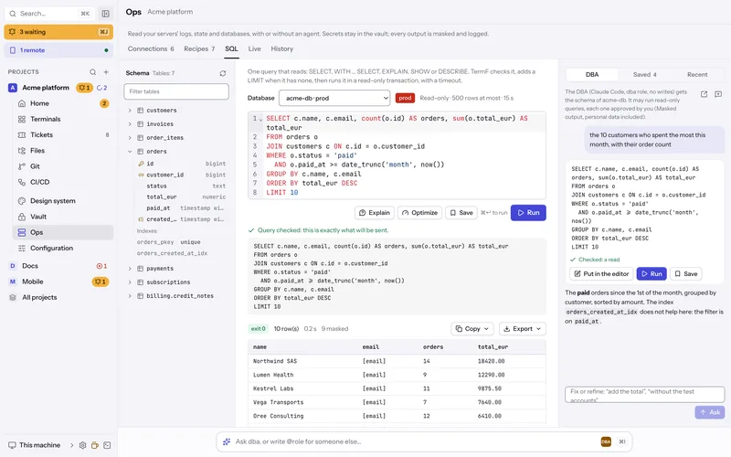

<p align="center">
  
</p>

<h1 align="center">TermF</h1>

<p align="center">
  <b>Ne parle qu'au CTO.</b><br>
  TermF est une app de bureau gratuite pour les développeurs qui utilisent Claude Code. Tu décris le travail à un seul agent, le CTO ;<br>
  une équipe d'agents IA le planifie, le code, le teste et le relit, puis t'apporte une pull request à valider.
</p>

<p align="center">
  <a href="https://vassilidev.github.io/TermF/"><b>Site</b></a> ·
  <a href="https://vassilidev.github.io/TermF/download.html"><b>Télécharger</b></a> ·
  <a href="https://vassilidev.github.io/TermF/docs/">Documentation</a> ·
  <a href="https://vassilidev.github.io/TermF/docs/team.html">L'équipe</a> ·
  <a href="README.md">English version</a>
</p>

<p align="center">
  <a href="https://github.com/vassilidev/TermF/releases/latest"></a>
  <a href="https://github.com/vassilidev/TermF/actions/workflows/ci.yml"></a>
  
  
  <a href="LICENSE"></a>
  <a href="https://code.claude.com"></a>
</p>

```sh
curl -fsSL https://vassilidev.github.io/TermF/install.sh | sh     # macOS, Linux
irm https://vassilidev.github.io/TermF/install.ps1 | iex          # Windows (PowerShell)
```

<p align="center"><sub>Une commande installe la dernière version pour ton système, vérifiée avec ses sommes SHA-256. Les autres façons, et ce qu'il te faut : <a href="#installer">Installer</a>.</sub></p>

<picture>
  <source media="(prefers-color-scheme: dark)" srcset="site/shots/home-dark.webp">
  
</picture>

## Ce que c'est

- **Une conversation par projet.** Sur l'Accueil de chaque projet, tu parles au CTO avec tes mots. Il lit tes dépôts, décide qui travaille sur une demande et te demande ton accord avant de lancer quoi que ce soit.
- **Une équipe de 29 agents, à la taille de chaque ticket.** Product owner, tech lead, front, back, QA, relecteurs du code et de la sécurité, chercheurs et spécialistes. Chacun est une session Claude Code avec son modèle et ses permissions, qui travaille dans sa propre copie du dépôt. Le CTO ne fait venir que ceux dont un ticket a besoin : un petit correctif a un développeur et une revue courte, sans rien te demander ; un ticket gros ou sensible a l'équipe complète et attend ton accord sur son plan. La pull request s'ouvre sur ton clic.
- **Toutes tes sessions Claude Code dans une seule fenêtre.** Claude Code, Codex, Gemini ou un shell, en onglets et en splits, avec celle qui travaille, celle qui t'attend et celle qui a fini.

Autour : Git, CI/CD, un coffre de mots de passe, serveurs et journaux, une vue du design system, la revue visuelle, la synchro chiffrée et la ligne de commande `termf`. Tout tourne sur ta machine : ni serveur TermF, ni compte, ni télémétrie.

## Installer

La commande du haut installe la dernière version pour ton système et ton processeur, vérifiée avec les sommes de contrôle de la release, sans étape de plus pour les builds non signés. Si elle échoue (une release sans sommes de contrôle), télécharge le fichier de ton système depuis [la page des releases](https://github.com/vassilidev/TermF/releases), comme ci-dessous. Ajoute `-s -- --beta` (ou `TERMF_BETA=1` sous Windows) pour prendre aussi les pré-versions. Ensuite TermF se met à jour seul : il cherche les mises à jour, vérifie leur signature et les installe quand tu cliques.

Ou télécharge le fichier de ton système depuis [la page de téléchargement](https://vassilidev.github.io/TermF/download.html) ou les [releases](https://github.com/vassilidev/TermF/releases) :

| Système | Fichier |
|---|---|
| macOS 11 ou plus récent, Apple Silicon | `TermF_<version>_aarch64.dmg` |
| macOS 11 ou plus récent, Intel | `TermF_<version>_x64.dmg` (ou `_universal.dmg` pour les deux) |
| Windows x64 | `TermF_<version>_x64-setup.exe`, ou le `.msi` (anglais ou français) |
| Windows ARM64 | `TermF_<version>_arm64-setup.exe` |
| Linux x86_64 ou ARM64 | `.AppImage`, `.deb` ou `.rpm` (WebKitGTK 4.1 requis) |

Téléchargés avec un navigateur, les builds ne sont **pas encore signés par Apple ni Microsoft** : le premier lancement demande une étape de plus.

- **macOS** : glisse TermF dans Applications, puis lève la quarantaine une fois : `xattr -dr com.apple.quarantine /Applications/TermF.app`. Ou ouvre-la une fois, puis clique sur « Ouvrir quand même » dans Réglages Système, Confidentialité et sécurité.
- **Windows** : sur l'avertissement SmartScreen, clique sur « Informations complémentaires », puis « Exécuter quand même ».
- **Linux** : `chmod +x` sur l'AppImage puis lance-la, ou `sudo apt install ./TermF_<version>_amd64.deb`, ou `sudo dnf install ./TermF-<version>-1.x86_64.rpm`.

**Il te faut** [Claude Code](https://code.claude.com) 2.1.288 ou plus récent, connecté, et `git`. La [CLI GitHub](https://cli.github.com), connectée, sert aux tickets GitHub, aux pull requests et à la CI. TermF trouve seul l'installation native de Claude Code et te dit comment mettre à jour une version trop ancienne.

## Démarrer en deux minutes

Au premier lancement, l'Accueil liste les outils qui manquent à TermF, avec la commande officielle pour installer chacun. Dans les Réglages, un clic met `termf` dans ton `PATH`.

1. **Crée un projet.** Clique sur <kbd>+</kbd> à côté de Projets. Choisis tes dépôts dans la liste (triés par activité, avec leur remote, leur branche et leur stack). TermF montre ce qu'il détecte dans chacun, puis propose l'équipe, les sources de tickets, la préparation des worktrees, la CI et les skills de ta stack. Accepte en un clic, ou mets un bloc de côté pour l'ajuster plus tard. Rien n'est écrit avant « Créer ». Pas encore de code ? **Pars de zéro** avec quelques phrases de ton idée : TermF crée le dépôt, et l'équipe la cadre, cherche ce qui existe et t'apporte une décision avant de construire le squelette.
2. **Ouvre ton premier agent.** <kbd>⌘T</kbd> ouvre Claude Code, ou un shell, dans n'importe quel dépôt, dans un onglet. <kbd>⌘D</kbd> partage la vue. Un badge et une notification te disent quand une session t'attend.
3. **Confie ta première tâche à l'équipe.** Sur l'Accueil du projet, écris au CTO : « Lance l'équipe sur #57 », ou décris le changement. Le CTO taille l'équipe au ticket : un petit correctif va à un développeur et une revue courte, sans rien te demander ; un ticket gros ou sensible te montre d'abord son parcours et son plan, avec des questions qui ont chacune une réponse proposée. Suis le run sur sa page, puis Livrer : TermF montre les fichiers et les commits, et ouvre la pull request quand tu confirmes.

<table>
  <tr>
    <td width="50%"><picture><source media="(prefers-color-scheme: dark)" srcset="site/shots/setup-dark-800.webp"></picture></td>
    <td width="50%"><picture><source media="(prefers-color-scheme: dark)" srcset="site/shots/greenfield-dark-800.webp"></picture></td>
  </tr>
  <tr>
    <td align="center"><sub>Depuis tes dépôts : la proposition</sub></td>
    <td align="center"><sub>Ou de zéro, à partir d'une idée</sub></td>
  </tr>
</table>

## Fonctionnalités

Chaque fonctionnalité est documentée sur le site, avec ce qui marche par défaut, ce qui se règle et ses limites : [la documentation](https://vassilidev.github.io/TermF/docs/) (en anglais).

### Le CTO et l'équipe

- **La conversation du CTO.** Une conversation permanente par projet. Chaque action du CTO (lancer un run, valider une étape, arrêter) est une carte que tu approuves. `@front` écrit à un agent au travail, `@expert` à l'expert du projet.
- **Demander depuis n'importe quel écran.** <kbd>⌘I</kbd> ouvre un panneau à côté de la vue, avec l'agent qui lui va (le lead sur un run, devops sur la CI/CD, le DBA dans le studio de bases, l'expert dans Git) et ce que tu regardes en contexte. Rien ne change sans ton accord.
- **Moins de demandes, mêmes garde-fous.** Dans un run, les commandes qui ne font que lire et les contrôles, tests et lint du projet passent sans te demander. Le CTO peut ajouter un rôle dont un ticket a besoin, et la pull request raconte ce qui a été fait et vérifié.
- **Le tri, à la taille du ticket.** Le CTO choisit comment l'équipe prend un ticket : les étapes, les agents, le budget, jamais plus qu'il n'en faut. Un changement trivial a un développeur et les contrôles du projet, un petit ticket un développeur et une revue courte ; seul un ticket gros, flou ou sensible a l'équipe complète, et attend ton accord sur son parcours et son plan.
- **Des questions avec réponses proposées.** Les questions ouvertes arrivent dans un seul formulaire, chacune avec sa raison et une réponse proposée : tu ne changes que ce qui ne va pas.
- **29 rôles.** Chaque rôle est un fichier Markdown que tu peux surcharger par projet, squad ou dépôt (modèle, effort, permissions, skills, chemins interdits).
- **Les squads.** Un gros projet peut se découper en squads, chacune avec son lead, ses membres, ses dépôts et ses chemins, modifiées dans la Configuration du projet ; chaque lead découpe sa part du travail en tâches.
- **Revue de code et revue de sécurité.** Après les tâches et tes contrôles, un relecteur lit tout le diff, puis un relecteur sécurité en deux passes ; chaque remarque retourne à la tâche qui l'a causée.
- **La base tenue à jour.** Avant la livraison, TermF fusionne le dernier main dans le run ; en cas de conflit, l'intégrateur le résout et les contrôles repassent.
- **L'expert du projet.** Répond aux questions sur le projet depuis une mémoire locale de ses conversations et de ses runs, avec ses sources.
- **Budgets, arrêt, reprise en main.** Chaque run a un budget (15 dollars par défaut) ; l'arrêt d'urgence interrompt tous les agents ; « Prendre la main » ouvre la conversation de n'importe quel agent dans un terminal.
- **Le navigateur des agents.** Les agents front, QA, UX et SEO pilotent un profil Chrome vierge, limité aux origines que tu autorises.

### Projets, tickets et runs

- **Les projets et leur création.** Un seul assistant guidé : choisis des dépôts ; TermF détecte stacks, commandes, CI et tickets, pose quelques questions avec une réponse proposée, et propose le reste.
- **Un projet de zéro.** Pars d'une idée : TermF crée le dépôt (et, si tu veux, son dépôt GitHub), puis le workflow `kickoff` la cadre, un chercheur et un analyste de la concurrence regardent ce qui existe, et tu tranches avant que le squelette soit construit.
- **« Aujourd'hui », sur l'Accueil du projet.** Où en sont les choses en une phrase, ce qui t'attend d'abord, les agents au travail en mots simples, les runs et les tickets à traiter.
- **Sources de tickets.** GitHub Issues, GitHub Projects, GitLab (livré en merge request), Jira Cloud, Linear, Azure DevOps ou n'importe quel serveur MCP ; plusieurs par projet.
- **La page Run.** Une page par ticket, du lancement au merge : étapes, une voie par agent avec ta réponse sur place, les fichiers modifiés, budget, journal.
- **Des runs sur plusieurs dépôts.** Un ticket qui touche l'API et le front reçoit une pull request dans chaque dépôt, liées entre elles.
- **Workflows et règles.** Les workflows sont des fichiers ; des règles comme « ne faire que ce que demande le ticket » ou « aucun texte non demandé » vont du conseil au blocage.
- **Livraison en deux temps.** Un aperçu exact de ce qui sera envoyé, puis ta confirmation ; les agents ne peuvent jamais pousser.
- **Git dans le projet.** Graphe des branches, branches et worktrees, indexer par fichier, bloc ou ligne, commit, stash, merge, rebase avec conflits, tags, historique et blame.
- **Le nettoyage Git.** Les branches et les worktrees qui peuvent partir, avec ce que chacun ferait perdre. Ce qui ne perd rien part tout de suite, avec Annuler, et un expert git t'aide à trier le reste.

<table>
  <tr>
    <td width="50%"><picture><source media="(prefers-color-scheme: dark)" srcset="site/shots/run-dark-800.webp"></picture></td>
    <td width="50%"><picture><source media="(prefers-color-scheme: dark)" srcset="site/shots/git-dark-800.webp"></picture></td>
  </tr>
  <tr>
    <td align="center"><sub>La page du run d'un ticket, avec les questions du plan</sub></td>
    <td align="center"><sub>La vue Git</sub></td>
  </tr>
</table>

### Terminaux

- **Onglets et splits**, comme dans Ghostty, pour Claude Code, Codex, Gemini ou un shell, avec l'état de chaque session et le remplissage de son contexte.
- **Remise à zéro du contexte avec passation.** Quand le contexte d'une session se remplit, TermF lui fait écrire une passation, le vide et reprend.
- **Remote Control** : reprends une session Claude Code depuis ton téléphone, avec son lien et son QR code, par session, par projet ou par rôle ; une icône dans la barre des menus et un badge sur le dock montrent ce qui t'attend.
- **Deux panneaux, l'aide et un guide au premier lancement** ; chaque raccourci se change.
- **Fichiers, terminal rapide et « rester éveillé »** : un explorateur avec recherche floue et un éditeur, un terminal sur <kbd>Ctrl+`</kbd>, et un interrupteur qui garde la machine éveillée pendant que les agents travaillent.

<picture>
  <source media="(prefers-color-scheme: dark)" srcset="site/shots/terminals-dark-800.webp">
  
</picture>

### Worktrees, bibliothèque et skills

- **Des worktrees prêts à tourner.** Chaque run travaille dans son propre worktree git, avec ses dépendances, ses fichiers `.env`, une base clonée et ses propres ports.
- **La bibliothèque.** Rôles, règles, skills, workflows et commandes en couches (livré, global, projet, dépôt). La recherche d'abord, ce qui est vraiment actif dans ce projet et pourquoi, et un interrupteur par élément, avec Annuler.
- **38 skills par stack**, activées selon ce que TermF trouve dans tes dépôts, plus des skills pour `git`, `gh`, `curl`, `jq`, `make` et d'autres pour tous les agents.
- **Serveurs de langage** : quand le serveur de langage de ta stack est installé (rust-analyzer, TypeScript, pyright, gopls…), les agents reçoivent ses diagnostics pendant qu'ils modifient le code ; les skills et rôles clés livrés ont leurs évals.
- **Des conventions en mots simples**, proposées depuis ton code et relues une par une, et une **veille** qui cherche sur le web de meilleures pratiques. Ce qu'elles proposent arrive dans un onglet « À faire », une action par ligne.

### Claude Code, autres agents et planificateur

- **La vue Claude Code** : réglages par portée, serveurs MCP, plugins, skills, agents, hooks, mémoire, sessions, usage et compte de cette machine.
- **L'usage et ses limites** : avec un abonnement Claude, les montants se lisent en équivalent API et les fenêtres de 5 h et de 7 jours restent en vue ; le CTO les consulte avant de lancer une équipe.
- **Les artifacts claude.ai**, listés et gérés depuis l'app.
- **Codex et Gemini** : trouvés quand ils sont installés, dans les terminaux et les conversations ; un rôle de l'équipe peut tourner sur l'un d'eux. Nouveau, pas encore essayé avec les vrais outils.
- **Le planificateur** : des tâches Claude à heure fixe, même app fermée.

### CI/CD, design et revue visuelle

- **CI/CD** : les exécutions GitHub Actions et leurs journaux dans l'app, avec le graphe des jobs en direct, la première erreur repérée, relancer et annuler, et un échec renvoyé à l'agent qui l'a causé ; les webhooks, et les déploiements par la ligne de commande de Laravel Forge, Vercel, Netlify, Fly.io ou Railway.
- **La vue Design system** : tes tokens et composants lus dans le code, avec chaque incohérence (valeurs en dur, couleurs presque identiques, contrastes sous WCAG AA, thème sombre incomplet), et une charte exportée en PDF. Elle charge les vraies polices du projet, avec un spécimen et les composants redessinés depuis ses tokens.
- **La revue visuelle** : captures avant / après de chaque écran modifié, côte à côte, avec un curseur, un calque ou une heatmap, des épingles, et un mode swipe pour les passer en revue.

<table>
  <tr>
    <td width="50%"><picture><source media="(prefers-color-scheme: dark)" srcset="site/shots/review-dark-800.webp"></picture></td>
    <td width="50%"><picture><source media="(prefers-color-scheme: dark)" srcset="site/shots/design-dark-800.webp"></picture></td>
  </tr>
  <tr>
    <td align="center"><sub>La revue visuelle</sub></td>
    <td align="center"><sub>La vue Design system</sub></td>
  </tr>
</table>

### Clés, coffre, synchro, serveurs

- **SSH et clés** dans tous les formats courants, avec l'agent et `~/.ssh/config`.
- **Le coffre** : identifiants avec codes 2FA, notes sécurisées et secrets par projet, chiffrés ; une clé de sécurité (FIDO2) comme second facteur, Touch ID ou Windows Hello ; import depuis Bitwarden, 1Password, les navigateurs et KeePassXC. Les agents ne voient jamais une valeur sans ton accord.
- **La synchro chiffrée** des réglages, des projets, du coffre et, si tu le choisis, des clés SSH, par git, un dossier, S3 ou WebDAV.
- **Serveurs, bases et journaux (Ops)** : SSH, Postgres, MySQL, Kubernetes et services de journaux, avec des recettes que tu lances, ou qu'un agent demande à lancer par une carte d'approbation, sortie masquée ; les journaux en direct, et le `.env` de prod comparé au tien.
- **Un studio de bases** : n'importe quelle base ajoutée par URL, depuis les fichiers de ton projet ou derrière SSH, son schéma, des requêtes sauvegardées et des exports, et le DBA pour écrire, expliquer ou optimiser une requête, toujours en lecture seule.
- **Un environnement minimal pour les agents** : ils ne reçoivent que les variables dont ils ont besoin ; une clé d'API du coffre seulement quand ils la demandent et que tu la donnes.

<table>
  <tr>
    <td width="50%"><picture><source media="(prefers-color-scheme: dark)" srcset="site/shots/vault-dark-800.webp"></picture></td>
    <td width="50%"><picture><source media="(prefers-color-scheme: dark)" srcset="site/shots/sql-dark-800.webp"></picture></td>
  </tr>
  <tr>
    <td align="center"><sub>Le coffre</sub></td>
    <td align="center"><sub>Le studio de bases</sub></td>
  </tr>
</table>

### L'installation et l'app

- **Une commande pour installer**, et des **mises à jour automatiques**, signées, sur un canal stable ou bêta.
- **Une app native** : un `.dmg` mis en page, des installeurs Windows en anglais et en français, `.deb`, `.rpm` et AppImage, un menu macOS natif, une fenêtre qui retient sa place.
- **Un espace de travail aux normes** : une navigation que tu redimensionnes ou replies en icônes, des splits en un raccourci, des menus au clic droit, et chaque écran marche dans une fenêtre étroite.

## L'équipe

Tu ne parles qu'au CTO. Il fait venir les agents dont un ticket a besoin, et laisse les autres de côté :

| Groupe | Agents |
|---|---|
| Tes interlocuteurs | CTO, expert du projet |
| Produit et design | Product manager, product owner, designer UX, architecte, chercheur, analyste de la concurrence, rétro-ingénieur |
| Planifier et construire | Tech lead, front, back, DevOps, SEO |
| Qualité et sécurité | QA, relecteur du code, relecteur sécurité, intégrateur |
| Marque, textes et vidéo | Designer de marque, rédacteur UX, motion designer |
| Spécialistes | Base de données, rédacteur technique, intégrations, fiabilité (SRE), accessibilité, IA, analytics produit, conformité |

Ce que fait chacun, quand il est appelé et ce qu'il ne fait jamais : [la page de l'équipe](https://vassilidev.github.io/TermF/docs/team.html).

<picture>
  <source media="(prefers-color-scheme: dark)" srcset="site/shots/team-dark-800.webp">
  
</picture>

## Équipe ou session seule ?

On a donné les mêmes tickets à l'équipe et à une simple session Claude Code : même modèle (Sonnet), tests cachés, juge à l'aveugle. Sur un **petit ticket clair**, une session seule suffit : même qualité, et l'équipe, même réduite à un développeur et une revue courte, coûte environ 3,4 fois plus (0,34 contre 0,10 dollar). Sur des **tickets complexes et réalistes** (partage avec des rôles, « l'appli est lente sur les grosses listes »), l'équipe a rempli plus de critères implicites, 90 % contre 72 %, avec plus de tests et aucune erreur de type, pour 4,8 fois le coût. Peu d'essais, un seul modèle : un premier regard, pas un verdict. Lire [The team or one session?](https://vassilidev.github.io/TermF/docs/team-vs-solo.html) (en anglais), ou le rapport complet dans [docs/BENCHMARK.md](docs/BENCHMARK.md).

## Sécurité et vie privée

- **Local.** Ni serveur TermF, ni télémétrie, ni compte. Ton code va là où Claude Code l'envoie, au modèle, comme sans TermF. Les autres connexions sont celles que tu configures : GitHub ou Jira pour les tickets, un remote de synchro, tes serveurs.
- **Tu valides les étapes clés.** La livraison t'attend toujours, le parcours et le plan d'un gros run aussi ; chaque action du CTO est une carte. Les agents ne peuvent ni pousser ni ouvrir de pull request : le hook `termf guard` le refuse dans chaque run, et un run ne démarre pas sans lui.
- **Une API locale isolée.** Chaque session d'agent reçoit son propre accès restreint à TermF ; ton jeton reste hors de portée, et les actions qui comptent attendent ta confirmation dans l'app.
- **Secrets.** Les fichiers `.env` et les clés privées sont refusés aux outils de fichiers des agents, et les agents démarrent avec un environnement minimal : une clé ne leur parvient que quand tu la donnes. Le coffre et la synchro sont chiffrés (Argon2id, XChaCha20-Poly1305) avec une clé de récupération. La sortie d'Ops est masquée avant qu'un agent la lise.
- **Des limites dites franchement.** Ces garde-fous sont une défense en profondeur sur une machine, pas un bac à sable : un script qu'un agent écrit puis lance peut encore les contourner. Chaque fonctionnalité est pilotée dans la vraie app par des tests de bout en bout avec un faux Claude Code, et des runs d'équipe complets sont allés jusqu'à une vraie pull request avec un vrai Claude Code, mais peu de choses ont été essayées à la main sur de vrais projets ; Windows et Linux sont construits et testés en CI mais pas encore lancés à la main. Le détail : [Security, and its limits](https://vassilidev.github.io/TermF/docs/security.html).

## Configuration

TermF écrit ses réglages dans des fichiers simples, dans ton dossier de configuration (`~/Library/Application Support/termf` sur macOS, `~/.config/termf` sur Linux, `%APPDATA%\termf` sur Windows) :

- `termf.toml` : où chercher les dépôts, tes agents, les raccourcis et le reste des réglages (l'app le modifie pour toi).
- `projects/<id>.toml` : un projet, ses dépôts, ses sources de tickets, son équipe et ses squads, et les surcharges `[roles.<rôle>]`.
- `local.toml` : les réglages propres à cette machine, jamais synchronisés.

```toml
# projects/acme.toml
name = "Acme"

[[repos]]
path = "~/code/acme/api"

[roles.front]
model = "opus"
skills = ["+accessibility"]
```

## La ligne de commande `termf`

Elle est livrée dans l'app : `TermF.app/Contents/MacOS/termf` sur macOS, `/usr/bin/termf` avec le `.deb` et le `.rpm`, à côté de l'app sous Windows. Réglages, Ce qu'il te faut, la met dans ton `PATH` en un clic. `termf help` liste toutes les commandes.

| | |
|---|---|
| Sessions | `termf ls`, `termf open <chemin>`, `termf say <session> <texte>`, `termf watch` |
| Tickets et runs | `termf inbox`, `termf run <ticket>`, `termf runs`, `termf deliver <run>`, `termf close <run>` |
| L'équipe | `termf team run`, `termf team status <run>`, `termf team approve <run> <étape>`, `termf team stop` |
| Agents et expert | `termf agent ls\|send\|takeover\|handback`, `termf ask <question>` |
| Bibliothèque | `termf library ls\|explain\|enable\|disable`, `termf library scout`, `termf config export\|import` |
| Machine | `termf ssh …`, `termf sync …`, `termf vault …`, `termf ops …`, `termf ci …`, `termf schedule …`, `termf review …` |

Les commandes qui lancent un run, livrent, valident une étape ou tapent dans une session attendent ta confirmation dans l'app.

## Développement

Un cœur en Rust, une fenêtre Tauri 2 sur la webview du système et une interface Svelte 5 avec xterm.js. La conception est dans [docs/ARCHITECTURE.md](docs/ARCHITECTURE.md), l'avancement dans [docs/STATUS.md](docs/STATUS.md), ce qui change d'une version à l'autre dans [CHANGELOG.md](CHANGELOG.md) (en anglais).

```sh
cd app && pnpm tauri dev                      # lancer l'app
cd app && pnpm check && pnpm build            # front
cd app && pnpm bundle                         # paquet de l'app avec la CLI termf embarquée
cargo fmt --all && cargo clippy --workspace --all-targets -- -D warnings && cargo test --workspace
```

Le clippy et les tests de l'app ont besoin de `app/build` : lance `pnpm build` avant. Les textes de l'interface sont dans `app/src/lib/i18n.ts`, en anglais et en français. Le site est dans `site/` : `python3 .github/scripts/docs.py` construit la documentation depuis le Markdown de `site/docs-src/`, et l'équipe depuis `site/roles.toml` et `library/roles/`.

## Licence

[MIT](LICENSE). Les captures utilisent des données fictives : l'utilisateur alex et les dépôts acme.
