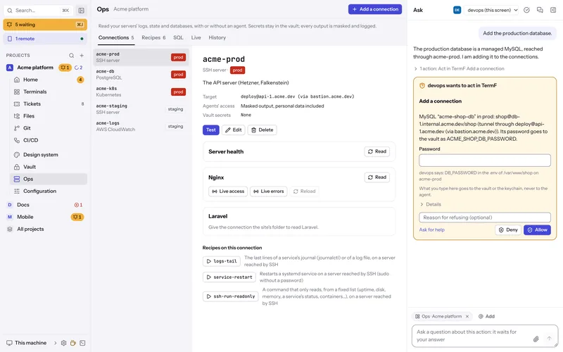
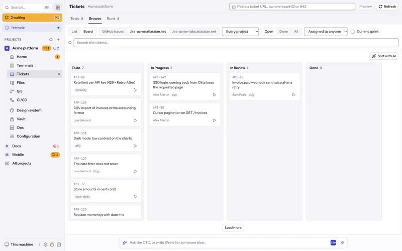

<p align="center">
  
</p>

<h1 align="center">TermF</h1>

<p align="center">
  <b>Mène une équipe d'agents Claude Code.</b><br>
  Donne-lui un ticket : un CTO le planifie, des spécialistes le codent et le testent en parallèle, un relecteur le vérifie. Tu approuves la pull request.
</p>

<p align="center">
  <a href="https://vassilidev.github.io/TermF/"><b>Site</b></a> ·
  <a href="https://vassilidev.github.io/TermF/download.html"><b>Télécharger</b></a> ·
  <a href="https://vassilidev.github.io/TermF/docs/">Documentation</a> ·
  <a href="README.md">English version</a>
</p>

<p align="center">
  <a href="https://github.com/vassilidev/TermF/releases/latest"></a>
  <a href="https://github.com/vassilidev/TermF/actions/workflows/ci.yml"></a>
  
  
  <a href="LICENSE"></a>
  <a href="https://code.claude.com"></a>
</p>

<p align="center">
  <a href="https://vassilidev.github.io/TermF/#film">
    <picture>
      <source media="(prefers-color-scheme: dark)" srcset="site/media/termf-film-poster-dark.webp">
      
    </picture>
  </a>
  <br><sub><a href="https://vassilidev.github.io/TermF/#film">Voir le film sur le site</a></sub>
</p>

## Installer

```sh
curl -fsSL https://vassilidev.github.io/TermF/install.sh | sh     # macOS, Linux
irm https://vassilidev.github.io/TermF/install.ps1 | iex          # Windows (PowerShell)
```

Il te faut [Claude Code](https://code.claude.com), connecté, et `git`. Tous les fichiers de ton système sont sur la [page de téléchargement](https://vassilidev.github.io/TermF/download.html), et les premiers pas dans le [guide d'installation](https://vassilidev.github.io/TermF/docs/installation.html).

## Ce que ça fait

- **Un ticket entre, une pull request relue sort.** Dis au CTO ce que tu veux : une équipe d'agents Claude Code, taillée pour le ticket, le planifie, le code, le teste et le relit.
- **Les agents agissent dans TermF, avec ton accord.** <kbd>⌘I</kbd> sur n'importe quel écran : l'agent ajoute une base, connecte Jira ou redéploie un site, chaque fois par une carte que tu valides.
- **Jira et un kanban.** Plusieurs sites et espaces Jira, un tableau pour chaque source de tickets, et chaque ticket lu en entier dans l'app.
- **Un studio de bases.** Des requêtes en lecture seule, des graphiques, le schéma complet en diagramme, et un DBA qui écrit la requête pour toi.
- **Ops.** La santé des serveurs, Nginx, Redis, Laravel et Laravel Forge, chaque changement attend ta confirmation.
- **Ta stack d'un coup d'œil.** Une carte des dépôts du projet et de leurs liens, chaque dépendance avec sa dernière version, sa fin de support et ses failles connues, et les mises à jour sûres en un clic.
- **Code sur n'importe quelle machine.** La synchro chiffrée apporte tes projets, ton coffre, tes clés SSH et ta config Claude Code sur chaque machine, et *Mon environnement* installe d'un coup tes outils sur une nouvelle.
- **Les secrets n'arrivent jamais aux agents.** Mots de passe et jetons vont au coffre, tapés par toi. Tout tourne sur ta machine : pas de serveur TermF, pas de compte.

<table>
  <tr>
    <td width="50%"><picture><source media="(prefers-color-scheme: dark)" srcset="site/shots/act-dark-800.webp"></picture></td>
    <td width="50%"><picture><source media="(prefers-color-scheme: dark)" srcset="site/shots/board-dark-800.webp"></picture></td>
  </tr>
</table>

## En savoir plus

La documentation est en anglais.

- [Ta première tâche pour le CTO](https://vassilidev.github.io/TermF/docs/first-task.html) et [le CTO et l'équipe](https://vassilidev.github.io/TermF/docs/team.html)
- [Les agents qui agissent pour toi](https://vassilidev.github.io/TermF/docs/agent-actions.html) et [demander depuis n'importe quel écran](https://vassilidev.github.io/TermF/docs/ask-panel.html)
- [Les tickets](https://vassilidev.github.io/TermF/docs/tickets.html), [Jira](https://vassilidev.github.io/TermF/docs/jira.html) et [le tableau des tickets](https://vassilidev.github.io/TermF/docs/kanban.html)
- [Le studio de bases](https://vassilidev.github.io/TermF/docs/database-studio.html) et [Ops](https://vassilidev.github.io/TermF/docs/ops.html)
- [Sécurité et vie privée](https://vassilidev.github.io/TermF/docs/security.html), [les bancs](https://vassilidev.github.io/TermF/benchmarks.html) et [ce qui a changé](CHANGELOG.md)

## Licence

[MIT](LICENSE). Les captures utilisent des données fictives : l'utilisateur alex et les dépôts acme. Pour contribuer, la conception est dans [docs/ARCHITECTURE.md](docs/ARCHITECTURE.md) et l'état d'avancement dans [docs/STATUS.md](docs/STATUS.md).
