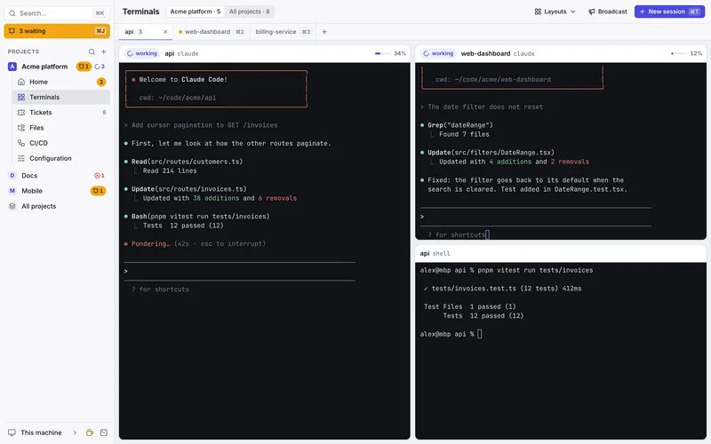
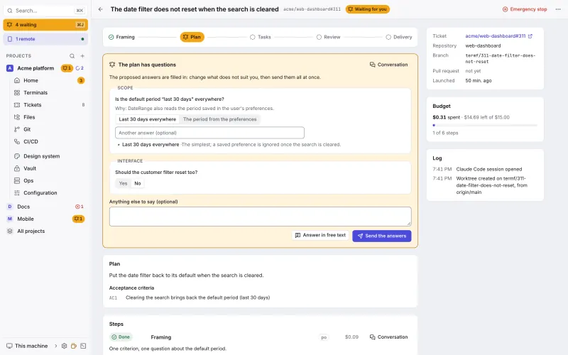
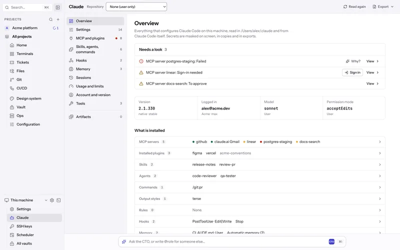

<p align="center">
  
</p>

<h1 align="center">TermF</h1>

<p align="center">
  <b>Le poste de pilotage de Claude Code, sur tous tes dépôts.</b><br>
  Parle au CTO, et une équipe d'agents mène tes tickets jusqu'à la pull request,<br>
  chaque run dans son propre worktree, en s'arrêtant pour ton accord à chaque étape clé.<br>
  Chaque Claude Code reste sous tes yeux, en onglets et en splits. Local d'abord, en Rust et Tauri.
</p>

<p align="center">
  <a href="https://vassilidev.github.io/TermF/"><b>Site</b></a> ·
  <a href="https://vassilidev.github.io/TermF/download.html"><b>Télécharger</b></a> ·
  <a href="https://github.com/vassilidev/TermF/releases">Releases</a> ·
  <a href="README.md">English version</a>
</p>

<p align="center">
  <a href="https://github.com/vassilidev/TermF/actions/workflows/ci.yml"></a>
  
  
  
  <a href="LICENSE"></a>
</p>

<picture>
  <source media="(prefers-color-scheme: dark)" srcset="site/shots/home-dark.webp">
  
</picture>

> [!NOTE]
> **En tout début de développement.** Les builds sont des pré-versions non signées. L'essentiel de l'interface a été vérifié par des tests automatiques et un backend simulé plutôt qu'à la main, et une partie du parcours a tourné avec un vrai Claude Code (un ticket ouvert dans son worktree, une équipe qui va du plan aux rapports des tâches). Attends-toi à des angles vifs, et [signale-les](https://github.com/vassilidev/TermF/issues).

## Ce que fait TermF

- **Chaque Claude Code sous tes yeux.** Des sessions en onglets et en splits libres, façon Ghostty (`⌘T`, `⌘D`, `⌘⇧D`, `⌥⌘` + flèches, chaque raccourci modifiable). Chacune dit si elle travaille, t'attend ou a fini, d'après les hooks de Claude Code lui-même, avec sa jauge de contexte et une notification quand elle a besoin de toi. `⌘J` mène à la prochaine chose qui t'attend, dans n'importe quel projet.
- **Un seul interlocuteur : le CTO.** Chaque projet s'ouvre sur son Accueil, avec une conversation permanente avec l'agent CTO. Demande une fonctionnalité, une correction ou où en sont les choses : le CTO trie chaque run, choisit son workflow, ses étapes et ses squads, et agit par les outils de TermF, chaque action derrière une carte d'approbation. Écris `@rôle` pour parler à quelqu'un d'autre.
- **Une équipe qui mène un ticket jusqu'à la pull request.** Tri, cadrage, plan, tâches en parallèle, contrôles, règles, revue de code, revue de sécurité, revue visuelle, livraison. Le plan arrive avec un questionnaire et des réponses proposées ; le plan, la revue visuelle et la livraison t'attendent. Chaque étape est une session d'agent neuve avec un brief, chaque run a un budget, et tu peux reprendre la main sur n'importe quelle conversation dans un terminal.
- **Les tickets là où ils sont.** GitHub Issues, GitHub Projects, Jira Cloud et n'importe quel serveur MCP, plusieurs sources par projet. Colle une URL ou une clé, suis une page par ticket, reprends un run après un redémarrage, nettoie après le merge.
- **Des worktrees prêts à tourner.** Un par run, dans le dépôt, pour que la confiance de Claude Code suive. La recette du projet installe les dépendances sans les copier telles quelles, repointe les fichiers `.env` vers le worktree, clone la base par worktree (Postgres, MySQL, SQLite) et lui donne ses propres ports.
- **Une bibliothèque à la mesure de ta stack.** Rôles, règles, skills, workflows et commandes en couches (livré, global, projet, dépôt). 25 rôles et 38 skills sont livrés avec TermF, et la stack détectée active ceux qui correspondent. L'assistant de mise en route lit un nouveau projet et propose son équipe, ses skills, ses sources de tickets et sa recette de worktree, élément par élément.
- **Un expert du projet qui a de la mémoire.** Un index local de ce dont le projet se souvient (conversations Claude Code, journaux des runs, bibliothèque, `CLAUDE.md`, docs, historique git), secrets masqués. Demande comment marche quelque chose et obtiens une réponse avec ses sources, dans l'app ou avec `termf ask`. L'équipe l'appelle au lieu de chercher de son côté.
- **Tout Claude Code dans une vue.** Réglages, permissions, hooks et environnement par portée, serveurs MCP, plugins, skills, agents, commandes, styles de sortie, fichiers de mémoire, sessions passées, usage et limites, compte et version, et un tableau triable de tes artifacts claude.ai.
- **Les corvées autour des agents.** Des clés SSH dans tous les formats avec l'agent et `~/.ssh/config`, une synchro des réglages chiffrée de bout en bout entre tes machines, les exécutions GitHub Actions et leurs journaux, un planificateur de tâches Claude (les tâches headless même quand TermF est fermé), un coffre pour les secrets (en ligne de commande pour l'instant), et un explorateur de fichiers avec recherche floue, un éditeur et des diffs.

## Captures

<table>
  <tr>
    <td width="50%"><picture><source media="(prefers-color-scheme: dark)" srcset="site/shots/terminals-dark-800.webp"></picture></td>
    <td width="50%"><picture><source media="(prefers-color-scheme: dark)" srcset="site/shots/run-dark-800.webp"></picture></td>
  </tr>
  <tr>
    <td align="center"><sub>Les Terminaux en onglets et en splits</sub></td>
    <td align="center"><sub>Le run d'un ticket, avec les questions du plan</sub></td>
  </tr>
  <tr>
    <td width="50%"><picture><source media="(prefers-color-scheme: dark)" srcset="site/shots/config-dark-800.webp"></picture></td>
    <td width="50%"><picture><source media="(prefers-color-scheme: dark)" srcset="site/shots/claude-dark-800.webp"></picture></td>
  </tr>
  <tr>
    <td align="center"><sub>L'équipe et les rôles d'un projet</sub></td>
    <td align="center"><sub>Tout Claude Code sur cette machine</sub></td>
  </tr>
</table>
<p align="center"><sub>Captures prises avec des données fictives : l'utilisateur alex et les dépôts acme. Interface en anglais sur les captures ; l'app est aussi en français.</sub></p>

## Installer

Le script d'installation prend la dernière release pour ton système, la vérifie avec le `SHA256SUMS` de la release et l'installe, sans étape de plus pour les builds non signés (ajoute `-s -- --beta` pour les pré-versions) :

```sh
curl -fsSL https://vassilidev.github.io/TermF/install.sh | sh                # macOS, Linux
irm https://vassilidev.github.io/TermF/install.ps1 | iex                     # Windows (PowerShell)
```

Télécharge TermF depuis [le site](https://vassilidev.github.io/TermF/download.html) ou les [releases](https://github.com/vassilidev/TermF/releases) :

| Système | Fichiers |
|---|---|
| macOS | `TermF_<version>_aarch64.dmg` (Apple Silicon), `TermF_<version>_x64.dmg` (Intel) |
| Windows | `TermF_<version>_x64-setup.exe`, ou `TermF_<version>_x64_en-US.msi` |
| Linux (x86_64) | `TermF_<version>_amd64.AppImage`, `.deb` ou `.rpm` (WebKitGTK 4.1 requis) |

Les builds ne sont pas encore signés, donc le premier lancement demande une étape de plus :

- **macOS** : après avoir déplacé TermF dans Applications, lance une fois `xattr -dr com.apple.quarantine /Applications/TermF.app` (ou clic droit sur l'app, Ouvrir, puis Ouvrir à nouveau).
- **Windows** : sur l'avertissement SmartScreen, clique sur « Informations complémentaires », puis « Exécuter quand même ».
- **Linux** : `chmod +x` sur l'AppImage, ou installe le `.deb` / `.rpm`.

TermF a besoin de [Claude Code](https://code.claude.com) installé et connecté, de `git`, et de la [CLI GitHub](https://cli.github.com) connectée pour les tickets GitHub, les pull requests et la CI/CD.

### Lancer depuis les sources

Prérequis : Rust (stable), Node 22+, pnpm et les [prérequis Tauri](https://tauri.app/start/prerequisites/) de ton OS.

```sh
git clone https://github.com/vassilidev/TermF.git
cd TermF/app
pnpm install
pnpm tauri dev
```

`pnpm bundle` construit les installeurs de ton système avec la CLI `termf` dedans (`pnpm tauri build` seul ne l'embarque pas).

### Configuration

Au premier lancement, TermF crée `termf.toml` dans ton dossier de config (`~/Library/Application Support/termf` sous macOS, `~/.config/termf` sous Linux, `%APPDATA%\termf` sous Windows). Par défaut il cherche les dépôts dans ton dossier personnel et propose un agent, `claude` ; ajoute les tiens :

```toml
roots = ["~", "D:/dev"]
scan_depth = 5

[agents]
claude = "claude"
codex = "codex"
```

Les projets sont à côté, dans `projects/<id>.toml`. L'app les écrit pour toi, et tu peux les modifier à la main :

```toml
name = "Acme"

[[repos]]
path = "~/Projects/acme-api"

[[repos]]
path = "~/Projects/acme-front"
```

## Premiers pas

1. **Ouvre TermF.** Il trouve les dépôts git de ta machine et les trie par activité.
2. **Crée un projet** à partir de quelques dépôts, avec le + à côté de Projets dans la navigation. L'assistant de mise en route s'ouvre une fois : il lit les dépôts sans rien modifier, pose les questions auxquelles toi seul peux répondre, puis propose l'équipe, les skills, les sources de tickets, la recette de worktree et la CI, élément par élément. Faire confiance aux dépôts dans Claude Code se fait seulement si tu l'acceptes.
3. **Parle au CTO** sur l'Accueil du projet (`⌘⇧H` depuis n'importe où) : « Où en est l'équipe ? », « Lance l'équipe sur #482 ». Ou ouvre Claude Code dans un terminal avec `⌘T`.
4. **Mets l'équipe sur un ticket** : demande-le au CTO, ou clique sur Avec l'équipe à côté d'un ticket dans Tickets. Réponds aux questions du plan, approuve le plan, suis le run sur sa page, puis Livrer… : TermF montre les fichiers et les commits, et ouvre la pull request une fois que tu confirmes.

## La ligne de commande `termf`

La CLI est livrée avec l'app : dans `TermF.app/Contents/MacOS/termf` sous macOS (fais-en un lien quelque part dans ton `PATH`), en `/usr/bin/termf` avec le `.deb` et le `.rpm`, à côté de l'app sous Windows. `termf help` liste toutes les commandes.

| | |
|---|---|
| Sessions | `termf ls`, `termf open <chemin> [--agent claude]`, `termf say <session> <texte>`, `termf watch` |
| Tickets et runs | `termf inbox`, `termf run <ticket>`, `termf runs`, `termf deliver <run>`, `termf close <run>` |
| L'équipe | `termf team run <run>`, `termf team status <run>`, `termf team answer …`, `termf team approve <run> <étape>`, `termf team stop` |
| Agents | `termf agent start`, `termf agent send <id> <texte>`, `termf agent takeover <id>`, `termf agent handback <id>` |
| L'expert | `termf ask <question>`, `termf memory search <requête>` |
| Bibliothèque et config | `termf library ls\|explain\|enable\|disable`, `termf library scout`, `termf config export\|import` |
| Machine | `termf ssh …`, `termf sync …`, `termf vault …`, `termf ci …`, `termf schedule …`, `termf claude …` |

Les commandes qui lancent un run ou une équipe, approuvent une étape ou répondent à ta place attendent ta confirmation dans l'app.

## Sécurité et vie privée

- **Local d'abord.** Aucun serveur TermF, aucune télémétrie. Ton code va là où Claude Code l'envoie, au modèle, comme il le ferait sans TermF. Les autres connexions sont celles que tu mets en place : GitHub ou Jira pour les tickets, le remote que tu choisis pour la synchro.
- **Un garde-fou sur chaque run.** Le hook `termf guard` refuse les push et les écritures dans le tracker dans les sessions d'un run et les étapes d'équipe, et un run ne démarre pas sans lui. La livraison se fait en deux temps : un aperçu, puis ta confirmation.
- **Une API locale isolée.** Chaque session d'agent reçoit sa propre capacité restreinte sur l'API locale de TermF ; ton jeton reste hors de portée des agents, et les actions qui comptent attendent ta confirmation dans l'app.
- **Ce qui n'est pas fiable reste une donnée.** Un ticket arrive à l'agent dans un fichier encadré, marqué non fiable. La conversation du CTO lit les dépôts mais n'a ni shell ni réseau.
- **Les secrets.** Les fichiers `.env` et les clés privées sont refusés aux outils de fichiers des sessions que TermF lance. Le coffre (Argon2id, mot de passe maître, verrouillage automatique, audit chaîné) et la synchro des réglages (Argon2id, XChaCha20-Poly1305, clé de récupération) sont chiffrés.
- **Limites, honnêtement.** Ces garde-fous sont une défense en profondeur sur une même machine, pas une frontière du système : un processus décidé à les contourner, comme un script qu'un agent écrit puis lance, le peut encore. L'interface a surtout été vérifiée avec un backend simulé, et les builds Windows et Linux sont testés en CI mais n'ont jamais été lancés à la main. Les points connus sont listés dans [docs/STATUS.md §4](docs/STATUS.md#4-dettes-et-points-non-vérifiés-connus).

## Architecture

Un cœur en Rust, une fenêtre Tauri 2 sur la webview du système, et une interface Svelte 5 avec xterm.js et CodeMirror. C'est TermF qui orchestre les agents : un modèle ne fait que planifier, et les agents passent par TermF (le journal du run et ses outils MCP), donc tout est visible, interruptible et chiffré en coût.

| | |
|---|---|
| `crates/termf-core` | Config (`termf.toml`, `projects/*.toml`), découverte des dépôts |
| `crates/termf-term` | Sessions PTY (portable-pty), ring buffer, attach et replay |
| `crates/termf-agents` | Sessions Claude Code headless en stream-json, prendre et rendre la main |
| `crates/termf-team` | L'équipe d'un run : sessions par rôle, le plan, le moteur de workflow, les étapes de validation, les budgets, les règles |
| `crates/termf-tickets` | Trackers, runs (SQLite, worktrees) et leurs pull requests |
| `crates/termf-worktree` | Préparation des worktrees selon la stack |
| `crates/termf-library` | La bibliothèque en couches et l'export / import de la config |
| `crates/termf-onboarding` | L'assistant de mise en route d'un projet |
| `crates/termf-memory` | La mémoire du projet où cherche l'expert |
| `crates/termf-visual` | La revue visuelle avant / après |
| `crates/termf-claude` | La config de Claude Code sur cette machine, les artifacts claude.ai |
| `crates/termf-ci`, `termf-schedule` | GitHub Actions, les tâches Claude planifiées |
| `crates/termf-ssh`, `termf-sync`, `termf-vault` | Clés SSH, synchro chiffrée, le coffre |
| `crates/termf-files` | Explorateur de fichiers, recherche floue, recherche |
| `crates/termf-cli` | La CLI `termf`, les hooks de Claude Code, le serveur `termf mcp` |
| `app/src-tauri`, `app/src` | L'hôte Tauri et ses commandes IPC ; l'interface SvelteKit |
| `library/` | Ce qui est livré : rôles, règles, skills, workflows, commandes |

La conception de référence est [docs/ARCHITECTURE.md](docs/ARCHITECTURE.md), et ce qui est fait est dans [docs/STATUS.md](docs/STATUS.md).

## Développement

```sh
cd app && pnpm tauri dev                      # lancer l'app
cd app && pnpm check && pnpm build            # front
cd app && pnpm bundle                         # paquet de l'app avec la CLI termf dedans
cargo fmt --all && cargo clippy --workspace --all-targets -- -D warnings && cargo test --workspace
```

Le clippy et les tests de l'app ont besoin de `app/build` : lance `pnpm build` avant. Les textes de l'interface sont dans `app/src/lib/i18n.ts`, en anglais et en français. Le site est dans `site/`, publié par le workflow Pages.

TermF est fait pour être forké et plié à ta façon de travailler. L'essentiel de la personnalisation vit dans des fichiers texte (réglages, rôles, règles, workflows, conventions) plutôt que dans le code, donc un fork peut rester petit et continuer de récupérer les évolutions. Les contributions sont bienvenues aussi.

## Feuille de route

- Builds signés et notarisés, mises à jour automatiques, budgets de performance et `cargo audit` en CI.
- L'interface du coffre et l'accès prod sécurisé : connexions, recettes en lecture seule, approbations.
- Des adaptateurs Codex et Gemini à côté de Claude Code.
- D'autres remotes de synchro (S3, WebDAV), et un ordonnanceur global pour toutes les équipes au travail.

La feuille de route complète est au [§17 d'ARCHITECTURE.md](docs/ARCHITECTURE.md#17-feuille-de-route).

## Licence

[MIT](LICENSE)
