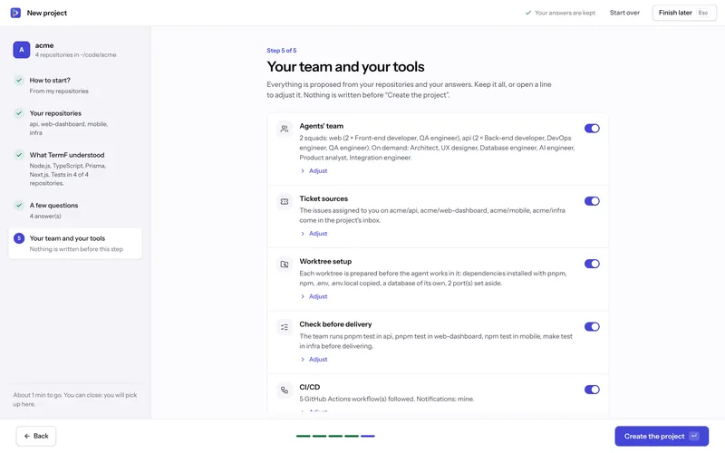
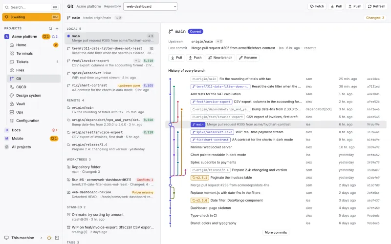
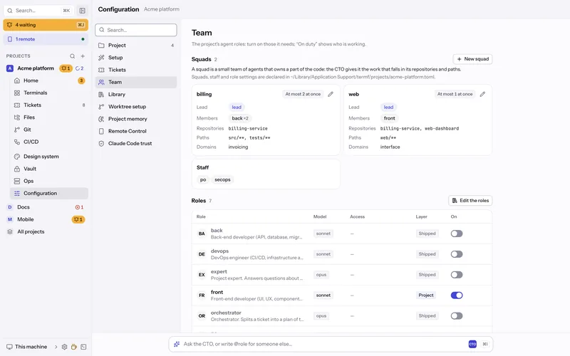
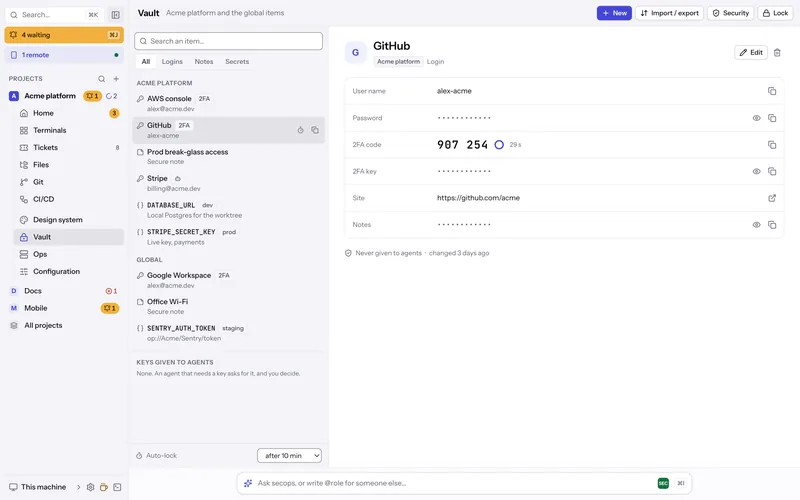
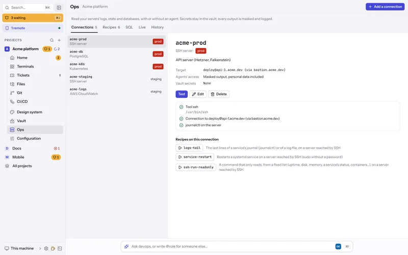

<p align="center">
  
</p>

<h1 align="center">TermF</h1>

<p align="center">
  <b>Ne parle qu'au CTO.</b><br>
  TermF est une app de bureau gratuite pour les développeurs qui utilisent Claude Code. Tu décris le travail à un seul agent, le CTO ;<br>
  une équipe d'agents IA le planifie, le code, le teste et le relit, puis t'apporte une pull request à valider.
</p>

<p align="center">
  <a href="https://vassilidev.github.io/TermF/"><b>Site</b></a> ·
  <a href="https://vassilidev.github.io/TermF/download.html"><b>Télécharger</b></a> ·
  <a href="https://vassilidev.github.io/TermF/features.html">Toutes les fonctionnalités</a> ·
  <a href="https://vassilidev.github.io/TermF/team.html">L'équipe</a> ·
  <a href="README.md">English version</a>
</p>

<p align="center">
  <a href="https://github.com/vassilidev/TermF/actions/workflows/ci.yml"></a>
  
  
  <a href="LICENSE"></a>
</p>

<picture>
  <source media="(prefers-color-scheme: dark)" srcset="site/shots/home-dark.webp">
  
</picture>

## Ce que c'est

- **Une conversation par projet.** Sur l'Accueil de chaque projet, tu parles au CTO avec tes mots. Il lit tes dépôts, décide qui travaille sur une demande et te demande ton accord avant de lancer quoi que ce soit.
- **Une équipe de 26 agents, un métier chacun.** Product owner, tech lead, front, back, QA, relecteurs du code et de la sécurité, et des spécialistes. Chacun est une session Claude Code avec son modèle et ses permissions, qui travaille dans sa propre copie du dépôt. Tu valides le plan et la livraison ; la pull request s'ouvre sur ton clic.
- **Toutes tes sessions Claude Code dans une seule fenêtre.** Claude Code, Codex, Gemini ou un shell, en onglets et en splits, avec celle qui travaille, celle qui t'attend et celle qui a fini.

Autour : Git, CI/CD, un coffre de mots de passe, serveurs et journaux, une vue du design system, la revue visuelle, la synchro chiffrée et la ligne de commande `termf`. Tout tourne sur ta machine : ni serveur TermF, ni compte, ni télémétrie.

## Installer

Une commande installe la dernière version pour ton système et ton processeur, vérifiée avec les sommes de contrôle de la release, sans étape de plus pour les builds non signés :

```sh
curl -fsSL https://vassilidev.github.io/TermF/install.sh | sh                # macOS, Linux
irm https://vassilidev.github.io/TermF/install.ps1 | iex                     # Windows (PowerShell)
```

Ajoute `-s -- --beta` (ou `TERMF_BETA=1` sous Windows) pour prendre aussi les pré-versions. Ensuite TermF se met à jour seul : il cherche les mises à jour, vérifie leur signature et les installe quand tu cliques.

Ou télécharge le fichier de ton système depuis [la page de téléchargement](https://vassilidev.github.io/TermF/download.html) ou les [releases](https://github.com/vassilidev/TermF/releases) :

| Système | Fichier |
|---|---|
| macOS, Apple Silicon | `TermF_<version>_aarch64.dmg` |
| macOS, Intel | `TermF_<version>_x64.dmg` |
| Windows | `TermF_<version>_x64-setup.exe`, ou le `.msi` |
| Linux x86_64 | `.AppImage`, `.deb` ou `.rpm` (WebKitGTK 4.1 requis) |

Téléchargés avec un navigateur, les builds ne sont **pas encore signés par Apple ni Microsoft** : le premier lancement demande une étape de plus.

- **macOS** : glisse TermF dans Applications, puis lève la quarantaine une fois : `xattr -dr com.apple.quarantine /Applications/TermF.app`. Ou ouvre-la une fois, puis clique sur « Ouvrir quand même » dans Réglages Système, Confidentialité et sécurité.
- **Windows** : sur l'avertissement SmartScreen, clique sur « Informations complémentaires », puis « Exécuter quand même ».
- **Linux** : `chmod +x` sur l'AppImage puis lance-la, ou `sudo apt install ./TermF_<version>_amd64.deb`, ou `sudo dnf install ./TermF-<version>-1.x86_64.rpm`.

**Il te faut** [Claude Code](https://code.claude.com) 2.1.288 ou plus récent, connecté, et `git`. La [CLI GitHub](https://cli.github.com), connectée, sert aux tickets GitHub, aux pull requests et à la CI. TermF trouve seul l'installation native de Claude Code et te dit comment mettre à jour une version trop ancienne.

## Démarrer en deux minutes

Au premier lancement, l'Accueil liste les outils qui manquent à TermF, avec la commande officielle pour installer chacun. Dans les Réglages, un clic met `termf` dans ton `PATH`.

1. **Crée un projet.** Clique sur <kbd>+</kbd> à côté de Projets. Choisis tes dépôts dans la liste (triés par activité, avec leur remote, leur branche et leur stack). TermF montre ce qu'il détecte dans chacun, puis propose l'équipe, les sources de tickets, la préparation des worktrees, la CI et les skills de ta stack. Accepte en un clic, ou mets un bloc de côté pour l'ajuster plus tard. Rien n'est écrit avant « Créer ».
2. **Ouvre ton premier agent.** <kbd>⌘T</kbd> ouvre Claude Code, ou un shell, dans n'importe quel dépôt, dans un onglet. <kbd>⌘D</kbd> partage la vue. Un badge et une notification te disent quand une session t'attend.
3. **Confie ta première tâche à l'équipe.** Sur l'Accueil du projet, écris au CTO : « Lance l'équipe sur #57 », ou décris le changement. Valide le parcours qu'il choisit, réponds à ses questions (chacune avec une réponse proposée), valide le plan, suis le run sur sa page, puis Livrer : TermF montre les fichiers et les commits, et ouvre la pull request quand tu confirmes.

<table>
  <tr>
    <td width="50%"><picture><source media="(prefers-color-scheme: dark)" srcset="site/shots/setup-dark-800.webp"></picture></td>
    <td width="50%"><picture><source media="(prefers-color-scheme: dark)" srcset="site/shots/run-dark-800.webp"></picture></td>
  </tr>
  <tr>
    <td align="center"><sub>Créer un projet : la proposition</sub></td>
    <td align="center"><sub>La page du run d'un ticket, avec les questions du plan</sub></td>
  </tr>
</table>

## Fonctionnalités

Chaque fonctionnalité a sa page sur le site, avec ce qui marche par défaut, ce qui se règle et ses limites : [le catalogue](https://vassilidev.github.io/TermF/features.html) (en anglais).

### Le CTO et l'équipe

- **La conversation du CTO.** Une conversation permanente par projet. Chaque action du CTO (lancer un run, valider une étape, arrêter) est une carte que tu approuves. `@front` écrit à un agent au travail, `@expert` à l'expert du projet.
- **Le tri.** Le CTO choisit comment l'équipe prend un ticket : les étapes, les agents, le budget. Ce parcours est la première chose que tu valides.
- **Des questions avec réponses proposées.** Les questions ouvertes arrivent dans un seul formulaire, chacune avec sa raison et une réponse proposée : tu ne changes que ce qui ne va pas.
- **26 rôles.** Chaque rôle est un fichier Markdown que tu peux surcharger par projet, squad ou dépôt (modèle, effort, permissions, skills, chemins interdits).
- **Les squads.** Un gros projet peut se découper en squads, chacune avec son lead, ses membres, ses dépôts et ses chemins, modifiées dans la Configuration du projet ; chaque lead découpe sa part du travail en tâches.
- **Revue de code et revue de sécurité.** Après les tâches et tes contrôles, un relecteur lit tout le diff, puis un relecteur sécurité en deux passes ; chaque remarque retourne à la tâche qui l'a causée.
- **La base tenue à jour.** Avant la livraison, TermF fusionne le dernier main dans le run ; en cas de conflit, l'intégrateur le résout et les contrôles repassent.
- **L'expert du projet.** Répond aux questions sur le projet depuis une mémoire locale de ses conversations et de ses runs, avec ses sources.
- **Budgets, arrêt, reprise en main.** Chaque run a un budget (15 dollars par défaut) ; l'arrêt d'urgence interrompt tous les agents ; « Prendre la main » ouvre la conversation de n'importe quel agent dans un terminal.
- **Le navigateur des agents.** Les agents front, QA, UX et SEO pilotent un profil Chrome vierge, limité aux origines que tu autorises.

### Projets, tickets et runs

- **Les projets et leur création.** Choisis des dépôts ; TermF détecte stacks, commandes, CI et tickets, et propose le reste.
- **L'Accueil du projet.** La conversation du CTO, ce qui t'attend, les agents au travail et les runs, sur un seul écran.
- **Sources de tickets.** GitHub Issues, GitHub Projects, Jira Cloud ou n'importe quel serveur MCP ; plusieurs par projet.
- **La page Run.** Une page par ticket, du lancement au merge : étapes, plan, questions, budget, journal.
- **Des runs sur plusieurs dépôts.** Un ticket qui touche l'API et le front reçoit une pull request dans chaque dépôt, liées entre elles.
- **Workflows et règles.** Les workflows sont des fichiers ; des règles comme « ne faire que ce que demande le ticket » ou « aucun texte non demandé » vont du conseil au blocage.
- **Livraison en deux temps.** Un aperçu exact de ce qui sera envoyé, puis ta confirmation ; les agents ne peuvent jamais pousser.
- **Git dans le projet.** Graphe des branches, branches et worktrees, indexer par fichier, bloc ou ligne, commit, stash, merge, rebase avec conflits, tags, historique et blame.

<table>
  <tr>
    <td width="50%"><picture><source media="(prefers-color-scheme: dark)" srcset="site/shots/git-dark-800.webp"></picture></td>
    <td width="50%"><picture><source media="(prefers-color-scheme: dark)" srcset="site/shots/team-dark-800.webp"></picture></td>
  </tr>
  <tr>
    <td align="center"><sub>La vue Git</sub></td>
    <td align="center"><sub>Les squads et les rôles d'un projet</sub></td>
  </tr>
</table>

### Terminaux

- **Onglets et splits**, comme dans Ghostty, pour Claude Code, Codex, Gemini ou un shell, avec l'état de chaque session et le remplissage de son contexte.
- **Remise à zéro du contexte avec passation.** Quand le contexte d'une session se remplit, TermF lui fait écrire une passation, le vide et reprend.
- **Deux panneaux, l'aide et une visite guidée** ; chaque raccourci se change.
- **Fichiers, terminal rapide et « rester éveillé »** : un explorateur avec recherche floue et un éditeur, un terminal sur <kbd>Ctrl+`</kbd>, et un interrupteur qui garde la machine éveillée pendant que les agents travaillent.

<picture>
  <source media="(prefers-color-scheme: dark)" srcset="site/shots/terminals-dark-800.webp">
  
</picture>

### Worktrees, bibliothèque et skills

- **Des worktrees prêts à tourner.** Chaque run travaille dans son propre worktree git, avec ses dépendances, ses fichiers `.env`, une base clonée et ses propres ports.
- **La bibliothèque.** Rôles, règles, skills, workflows et commandes en couches (livré, global, projet, dépôt).
- **38 skills par stack**, activées selon ce que TermF trouve dans tes dépôts, plus des skills pour `git`, `gh`, `curl`, `jq`, `make` et d'autres pour tous les agents.
- **Des conventions en mots simples**, proposées depuis ton code et relues une par une, et une **veille** qui cherche sur le web de meilleures pratiques.

### Claude Code, autres agents et planificateur

- **La vue Claude Code** : réglages par portée, serveurs MCP, plugins, skills, agents, hooks, mémoire, sessions, usage et compte de cette machine.
- **Les artifacts claude.ai**, listés et gérés depuis l'app.
- **Codex et Gemini** : trouvés quand ils sont installés, dans les terminaux et les conversations ; un rôle de l'équipe peut tourner sur l'un d'eux. Nouveau, pas encore essayé avec les vrais outils.
- **Le planificateur** : des tâches Claude à heure fixe, même app fermée.

### CI/CD, design et revue visuelle

- **CI/CD** : les exécutions GitHub Actions et leurs journaux dans l'app, avec la première erreur repérée, relancer et annuler, et un échec renvoyé à l'agent qui l'a causé.
- **La vue Design system** : tes tokens et composants lus dans le code, avec chaque incohérence (valeurs en dur, couleurs presque identiques, contrastes sous WCAG AA, thème sombre incomplet), et une charte exportée en PDF.
- **La revue visuelle** : captures avant / après de chaque écran modifié, côte à côte, avec un curseur, un calque ou une heatmap, des épingles, et un mode swipe pour les passer en revue.

<table>
  <tr>
    <td width="50%"><picture><source media="(prefers-color-scheme: dark)" srcset="site/shots/review-dark-800.webp"></picture></td>
    <td width="50%"><picture><source media="(prefers-color-scheme: dark)" srcset="site/shots/design-dark-800.webp"></picture></td>
  </tr>
  <tr>
    <td align="center"><sub>La revue visuelle</sub></td>
    <td align="center"><sub>La vue Design system</sub></td>
  </tr>
</table>

### Clés, coffre, synchro, serveurs

- **SSH et clés** dans tous les formats courants, avec l'agent et `~/.ssh/config`.
- **Le coffre** : identifiants avec codes 2FA, notes sécurisées et secrets par projet, chiffrés ; une clé de sécurité (FIDO2) comme second facteur, Touch ID ou Windows Hello ; import depuis Bitwarden, 1Password, les navigateurs et KeePassXC. Les agents ne voient jamais une valeur sans ton accord.
- **La synchro chiffrée** des réglages, des projets, du coffre et, si tu le choisis, des clés SSH, par git, un dossier, S3 ou WebDAV.
- **Serveurs, bases et journaux (Ops)** : SSH, Postgres, MySQL, Kubernetes et services de journaux, avec des recettes que tu lances, ou qu'un agent demande à lancer par une carte d'approbation, sortie masquée.

<table>
  <tr>
    <td width="50%"><picture><source media="(prefers-color-scheme: dark)" srcset="site/shots/vault-dark-800.webp"></picture></td>
    <td width="50%"><picture><source media="(prefers-color-scheme: dark)" srcset="site/shots/ops-dark-800.webp"></picture></td>
  </tr>
  <tr>
    <td align="center"><sub>Le coffre</sub></td>
    <td align="center"><sub>Ops : connexions et recettes</sub></td>
  </tr>
</table>

## L'équipe

Tu ne parles qu'au CTO. Il fait venir les agents dont un ticket a besoin :

| Groupe | Agents |
|---|---|
| Tes interlocuteurs | CTO, expert du projet |
| Produit et design | Product manager, product owner, designer UX, architecte |
| Planifier et construire | Tech lead, front, back, DevOps, SEO |
| Qualité et sécurité | QA, relecteur du code, relecteur sécurité, intégrateur |
| Marque, textes et vidéo | Designer de marque, rédacteur UX, motion designer |
| Spécialistes | Base de données, rédacteur technique, intégrations, fiabilité (SRE), accessibilité, IA, analytics produit, conformité |

Ce que fait chacun, quand il est appelé et ce qu'il ne fait jamais : [la page de l'équipe](https://vassilidev.github.io/TermF/team.html).

## Sécurité et vie privée

- **Local.** Ni serveur TermF, ni télémétrie, ni compte. Ton code va là où Claude Code l'envoie, au modèle, comme sans TermF. Les autres connexions sont celles que tu configures : GitHub ou Jira pour les tickets, un remote de synchro, tes serveurs.
- **Tu valides les étapes clés.** Le parcours, le plan et la livraison t'attendent ; chaque action du CTO est une carte. Les agents ne peuvent ni pousser ni ouvrir de pull request : le hook `termf guard` le refuse dans chaque run, et un run ne démarre pas sans lui.
- **Une API locale isolée.** Chaque session d'agent reçoit son propre accès restreint à TermF ; ton jeton reste hors de portée, et les actions qui comptent attendent ta confirmation dans l'app.
- **Secrets.** Les fichiers `.env` et les clés privées sont refusés aux outils de fichiers des agents. Le coffre et la synchro sont chiffrés (Argon2id, XChaCha20-Poly1305) avec une clé de récupération. La sortie d'Ops est masquée avant qu'un agent la lise.
- **Des limites dites franchement.** Ces garde-fous sont une défense en profondeur sur une machine, pas un bac à sable : un script qu'un agent écrit puis lance peut encore les contourner. L'interface a surtout été vérifiée par des tests automatiques et un backend simulé ; Windows et Linux sont construits et testés en CI mais pas encore lancés à la main. Le détail : [Security, and its limits](https://vassilidev.github.io/TermF/security.html).

## Configuration

TermF écrit ses réglages dans des fichiers simples, dans ton dossier de configuration (`~/Library/Application Support/termf` sur macOS, `~/.config/termf` sur Linux, `%APPDATA%\termf` sur Windows) :

- `termf.toml` : où chercher les dépôts, tes agents, les raccourcis et le reste des réglages (l'app le modifie pour toi).
- `projects/<id>.toml` : un projet, ses dépôts, ses sources de tickets, son équipe et ses squads, et les surcharges `[roles.<rôle>]`.
- `local.toml` : les réglages propres à cette machine, jamais synchronisés.

```toml
# projects/acme.toml
name = "Acme"

[[repos]]
path = "~/code/acme/api"

[roles.front]
model = "opus"
skills = ["+accessibility"]
```

## La ligne de commande `termf`

Elle est livrée dans l'app : `TermF.app/Contents/MacOS/termf` sur macOS (à lier dans ton `PATH`), `/usr/bin/termf` avec le `.deb` et le `.rpm`, à côté de l'app sous Windows. `termf help` liste toutes les commandes.

| | |
|---|---|
| Sessions | `termf ls`, `termf open <chemin>`, `termf say <session> <texte>`, `termf watch` |
| Tickets et runs | `termf inbox`, `termf run <ticket>`, `termf runs`, `termf deliver <run>`, `termf close <run>` |
| L'équipe | `termf team run`, `termf team status <run>`, `termf team approve <run> <étape>`, `termf team stop` |
| Agents et expert | `termf agent ls\|send\|takeover\|handback`, `termf ask <question>` |
| Bibliothèque | `termf library ls\|explain\|enable\|disable`, `termf library scout`, `termf config export\|import` |
| Machine | `termf ssh …`, `termf sync …`, `termf vault …`, `termf ops …`, `termf ci …`, `termf schedule …`, `termf review …` |

Les commandes qui lancent un run, livrent, valident une étape ou tapent dans une session attendent ta confirmation dans l'app.

## Développement

Un cœur en Rust, une fenêtre Tauri 2 sur la webview du système et une interface Svelte 5 avec xterm.js. La conception est dans [docs/ARCHITECTURE.md](docs/ARCHITECTURE.md), l'avancement dans [docs/STATUS.md](docs/STATUS.md).

```sh
cd app && pnpm tauri dev                      # lancer l'app
cd app && pnpm check && pnpm build            # front
cd app && pnpm bundle                         # paquet de l'app avec la CLI termf embarquée
cargo fmt --all && cargo clippy --workspace --all-targets -- -D warnings && cargo test --workspace
```

Le clippy et les tests de l'app ont besoin de `app/build` : lance `pnpm build` avant. Les textes de l'interface sont dans `app/src/lib/i18n.ts`, en anglais et en français. Le site est dans `site/` : `python3 .github/scripts/features.py` construit les pages des fonctionnalités et l'équipe depuis `site/features.toml`, `site/roles.toml` et `library/roles/`.

## Licence

[MIT](LICENSE). Les captures utilisent des données fictives : l'utilisateur alex et les dépôts acme.
