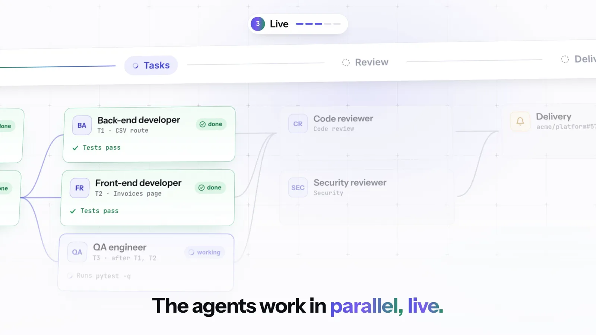
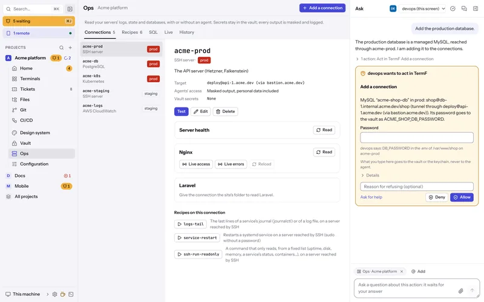
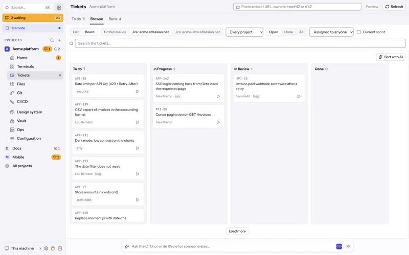

<p align="center">
  
</p>

<h1 align="center">TermF</h1>

<p align="center">
  <b>Stop using Claude Code (alone).</b><br>
  Tickets in, reviewed pull requests out. A CTO and a team of Claude Code agents work on your machine, and you approve.
</p>

<p align="center">
  <a href="https://vassilidev.github.io/TermF/"><b>Website</b></a> ·
  <a href="https://vassilidev.github.io/TermF/download.html"><b>Download</b></a> ·
  <a href="https://vassilidev.github.io/TermF/docs/">Documentation</a> ·
  <a href="README.fr.md">Version française</a>
</p>

<p align="center">
  <a href="https://github.com/vassilidev/TermF/releases/latest"></a>
  <a href="https://github.com/vassilidev/TermF/actions/workflows/ci.yml"></a>
  
  
  <a href="LICENSE"></a>
  <a href="https://code.claude.com"></a>
</p>

<p align="center">
  <a href="https://vassilidev.github.io/TermF/#film">
    <picture>
      <source media="(prefers-color-scheme: dark)" srcset="site/media/termf-film-poster-dark.webp">
      
    </picture>
  </a>
  <br><sub><a href="https://vassilidev.github.io/TermF/#film">Watch the film on the website</a></sub>
</p>

## Install

```sh
curl -fsSL https://vassilidev.github.io/TermF/install.sh | sh     # macOS, Linux
irm https://vassilidev.github.io/TermF/install.ps1 | iex          # Windows (PowerShell)
```

You need [Claude Code](https://code.claude.com), signed in, and `git`. Every file for your system is on the [download page](https://vassilidev.github.io/TermF/download.html), and the first steps in the [installation guide](https://vassilidev.github.io/TermF/docs/installation.html).

## What it does

- **A ticket goes in, a reviewed pull request comes out.** Tell the CTO what you want: a team of Claude Code agents, sized to the ticket, plans, codes, tests and reviews it.
- **Agents act in TermF, with your OK.** Press <kbd>⌘I</kbd> on any screen: the agent adds a database, connects Jira or redeploys a site, each time through a card you approve.
- **Jira and a kanban.** Several Jira sites and spaces, a board for every ticket source, and each ticket read in full in the app.
- **A database studio.** Read-only queries, charts, the whole schema as a diagram, and a DBA that writes the query for you.
- **Ops.** Server health, Nginx, Redis, Laravel and Laravel Forge, every change waiting for your confirmation.
- **Secrets never reach the agents.** Passwords and tokens go to the vault, typed by you. Everything runs on your machine: no TermF server, no account.

<table>
  <tr>
    <td width="50%"><picture><source media="(prefers-color-scheme: dark)" srcset="site/shots/act-dark-800.webp"></picture></td>
    <td width="50%"><picture><source media="(prefers-color-scheme: dark)" srcset="site/shots/board-dark-800.webp"></picture></td>
  </tr>
</table>

## Learn more

- [Your first task for the CTO](https://vassilidev.github.io/TermF/docs/first-task.html) and [the CTO and the team](https://vassilidev.github.io/TermF/docs/team.html)
- [Agents that act for you](https://vassilidev.github.io/TermF/docs/agent-actions.html) and [asking from any screen](https://vassilidev.github.io/TermF/docs/ask-panel.html)
- [Tickets](https://vassilidev.github.io/TermF/docs/tickets.html), [Jira](https://vassilidev.github.io/TermF/docs/jira.html) and [the ticket board](https://vassilidev.github.io/TermF/docs/kanban.html)
- [The database studio](https://vassilidev.github.io/TermF/docs/database-studio.html) and [Ops](https://vassilidev.github.io/TermF/docs/ops.html)
- [Security and privacy](https://vassilidev.github.io/TermF/docs/security.html), [the benchmarks](https://vassilidev.github.io/TermF/benchmarks.html) and [what changed](CHANGELOG.md)

## License

[MIT](LICENSE). Screenshots use fictional data: the user alex and the acme repositories. To contribute, the design is in [docs/ARCHITECTURE.md](docs/ARCHITECTURE.md) and the state of the work in [docs/STATUS.md](docs/STATUS.md), both in French.
