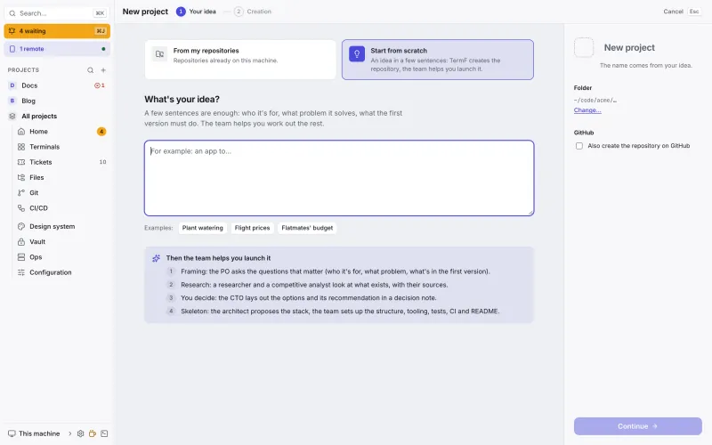
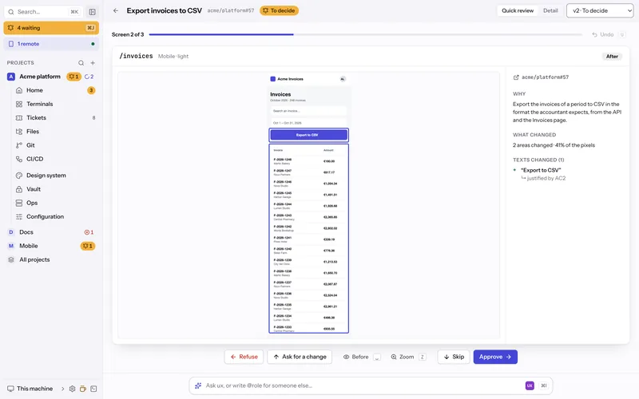
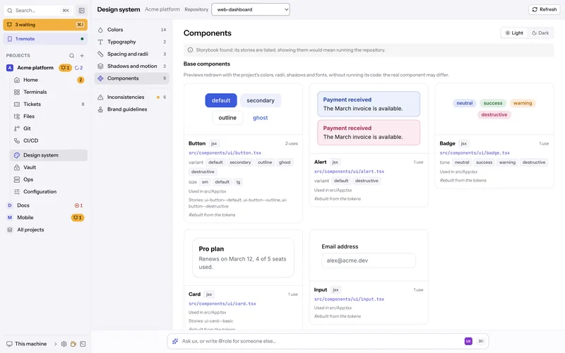
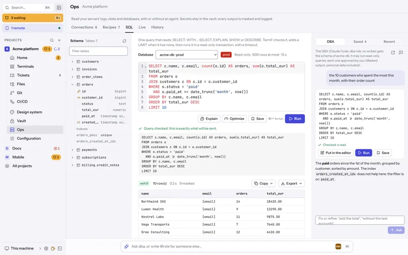

<p align="center">
  
</p>

<h1 align="center">TermF</h1>

<p align="center">
  <b>Talk only to the CTO.</b><br>
  TermF is a free desktop app for developers who use Claude Code. You describe the work to one agent, the CTO;<br>
  a team of AI agents plans it, codes it, tests it and reviews it, then brings you a pull request to approve.
</p>

<p align="center">
  <a href="https://vassilidev.github.io/TermF/"><b>Website</b></a> ·
  <a href="https://vassilidev.github.io/TermF/download.html"><b>Download</b></a> ·
  <a href="https://vassilidev.github.io/TermF/docs/">Documentation</a> ·
  <a href="https://vassilidev.github.io/TermF/docs/team.html">The team</a> ·
  <a href="README.fr.md">Version française</a>
</p>

<p align="center">
  <a href="https://github.com/vassilidev/TermF/actions/workflows/ci.yml"></a>
  
  
  <a href="LICENSE"></a>
</p>

```sh
curl -fsSL https://vassilidev.github.io/TermF/install.sh | sh     # macOS, Linux
irm https://vassilidev.github.io/TermF/install.ps1 | iex          # Windows (PowerShell)
```

<p align="center"><sub>One command installs the latest release for your system, checked against its SHA-256 sums. Other ways, and what you need: <a href="#install">Install</a>.</sub></p>

<picture>
  <source media="(prefers-color-scheme: dark)" srcset="site/shots/home-dark.webp">
  
</picture>

## What it is

- **One conversation per project.** On each project's Home, you talk to the CTO in your own words. It reads your repositories, decides who works on a request, and asks you before anything starts.
- **A team of 29 agents, sized to each ticket.** Product owner, tech lead, front-end, back-end, QA, code and security reviewers, researchers and specialists. Each one is a Claude Code session with its own model and permissions, working in its own copy of the repository. The CTO brings in only those a ticket needs: a small fix gets one developer and a short review and asks you nothing; a large or sensitive one gets the full team and waits for your OK on its plan. The pull request opens on your click.
- **All your Claude Code sessions in one window.** Claude Code, Codex, Gemini or a shell, in tabs and splits, with which one is working, waiting for you or done.

Around that: Git, CI/CD, a password vault, servers and logs, a design system view, visual review, encrypted sync, and the `termf` command line. Everything runs on your machine: no TermF server, no account, no telemetry.

## Install

The command at the top installs the latest release for your system and processor, checked against the release's checksums, with no extra step for the unsigned builds. If it fails (a release without checksums), download the file for your system from the [releases page](https://github.com/vassilidev/TermF/releases), as below. Add `-s -- --beta` (or `TERMF_BETA=1` on Windows) to take the pre-releases too. Then TermF keeps itself up to date: it checks for updates, verifies their signature and installs them when you click.

Or download the file for your system from the [download page](https://vassilidev.github.io/TermF/download.html) or the [releases](https://github.com/vassilidev/TermF/releases):

| System | File |
|---|---|
| macOS 11 or later, Apple Silicon | `TermF_<version>_aarch64.dmg` |
| macOS 11 or later, Intel | `TermF_<version>_x64.dmg` (or `_universal.dmg` for both) |
| Windows x64 | `TermF_<version>_x64-setup.exe`, or the `.msi` (English or French) |
| Windows ARM64 | `TermF_<version>_arm64-setup.exe` |
| Linux x86_64 or ARM64 | `.AppImage`, `.deb` or `.rpm` (needs WebKitGTK 4.1) |

Downloaded with a browser, the builds are **not signed by Apple or Microsoft yet**, so the first launch takes one extra step:

- **macOS**: drag TermF to Applications, then clear the quarantine once: `xattr -dr com.apple.quarantine /Applications/TermF.app`. Or open it once, then click Open Anyway in System Settings, Privacy & Security.
- **Windows**: on the SmartScreen warning, click More info, then Run anyway.
- **Linux**: `chmod +x` the AppImage and run it, or `sudo apt install ./TermF_<version>_amd64.deb`, or `sudo dnf install ./TermF-<version>-1.x86_64.rpm`.

**You need** [Claude Code](https://code.claude.com) 2.1.288 or later, signed in, and `git`. The [GitHub CLI](https://cli.github.com), signed in, is needed for GitHub tickets, pull requests and CI. TermF finds Claude Code's native install by itself and tells you how to update an older one.

## Start in two minutes

On first launch, the Home lists the tools TermF needs that are missing, with the official command to install each one. In Settings, one click puts `termf` on your `PATH`.

1. **Create a project.** Press <kbd>+</kbd> next to Projects. Pick your repositories in the list (sorted by activity, with their remote, branch and stack). TermF shows what it detects in each one, then proposes the team, the ticket sources, the worktree setup, CI and the skills for your stack. Accept them in one click, or set one aside to adjust later. Nothing is written before you click Create. No code yet? **Start from scratch** with a few sentences of your idea: TermF creates the repository, and the team frames it, researches it and brings you a decision before building the skeleton.
2. **Open your first agent.** <kbd>⌘T</kbd> opens Claude Code, or a shell, in any repository, in a tab. <kbd>⌘D</kbd> splits the view. A badge and a notification tell you when a session waits for you.
3. **Give your first task to the team.** On the project's Home, write to the CTO: "Start the team on #57", or describe the change. The CTO sizes the team to the ticket: a small fix goes to one developer and a short review without asking you anything; a large or sensitive one shows you its route and its plan first, with questions that come with a proposed answer. Follow the run on its page, then Deliver: TermF shows the files and commits, and opens the pull request once you confirm.

<table>
  <tr>
    <td width="50%"><picture><source media="(prefers-color-scheme: dark)" srcset="site/shots/setup-dark-800.webp"></picture></td>
    <td width="50%"><picture><source media="(prefers-color-scheme: dark)" srcset="site/shots/greenfield-dark-800.webp"></picture></td>
  </tr>
  <tr>
    <td align="center"><sub>From your repositories: the proposal</sub></td>
    <td align="center"><sub>Or from scratch, from an idea</sub></td>
  </tr>
</table>

## Features

Every feature is documented on the website, with what works out of the box, what you can tune and its limits: [the docs](https://vassilidev.github.io/TermF/docs/).

### The CTO and the team

- **The CTO's conversation.** One permanent conversation per project. Each action the CTO takes (start a run, approve a step, stop) is a card you approve. `@front` writes to an agent at work, `@expert` to the project expert.
- **Triage, sized to the ticket.** The CTO picks how the team takes a ticket: the steps, the agents, the budget, never more than it needs. A trivial change gets one developer and the project's checks, a small one a developer and a short review; only a large, vague or sensitive one gets the full team, and waits for your OK on its route and plan.
- **Questions with proposed answers.** Open questions arrive in one form, each with a reason and a proposed answer: you only change what is wrong.
- **29 roles.** Each role is a Markdown file you can override per project, squad or repository (model, effort, permissions, skills, paths it may not touch).
- **Squads.** A bigger project can split into squads, each with its lead, members, repositories and paths, edited in the project's Configuration; each lead splits its share of the work into tasks.
- **Code review and security review.** After the tasks and your checks, a reviewer reads the whole diff, then a security reviewer in two passes; each finding goes back to the task that made it.
- **The base kept up to date.** Before the delivery, TermF merges the latest main into the run; on a conflict, the merge integrator resolves it and the checks run again.
- **The project expert.** Answers questions about the project from a local memory of its conversations and runs, with sources.
- **Budgets, stop, take over.** Each run has a budget (15 dollars by default); the emergency stop interrupts every agent; Take over opens any agent's conversation in a terminal.
- **The agents' browser.** Front, QA, UX and SEO agents can drive a clean Chrome profile limited to the origins you allow.

### Projects, tickets and runs

- **Projects and the setup.** Pick repositories; TermF detects stacks, commands, CI and tickets, and proposes the rest.
- **A project from scratch.** Start from an idea: TermF creates the repository (and, if you like, its GitHub repository), then the `kickoff` workflow frames it, a researcher and a competitive analyst look at what exists, and you settle the decision before the skeleton is built.
- **The project's Home.** The CTO's conversation, what waits for you, the agents at work and the runs, on one screen.
- **Ticket sources.** GitHub Issues, GitHub Projects, GitLab (delivered as a merge request), Jira Cloud, Linear, Azure DevOps, or any MCP server; several per project.
- **The run page.** One page per ticket, from launch to merge: steps, plan, questions, budget, log.
- **Runs across repositories.** A ticket that touches the API and the front end gets one pull request in each repository, linked together.
- **Workflows and rules.** Workflows are files; rules like "do only what the ticket asks" or "no unrequested text changes" go from advice to blocking.
- **Delivery in two steps.** A preview of exactly what will be sent, then your confirmation; agents can never push.
- **Git in the project.** Branch graph, branches and worktrees, stage by file, hunk or line, commit, stash, merge, rebase with conflicts, tags, history and blame.

<table>
  <tr>
    <td width="50%"><picture><source media="(prefers-color-scheme: dark)" srcset="site/shots/run-dark-800.webp"></picture></td>
    <td width="50%"><picture><source media="(prefers-color-scheme: dark)" srcset="site/shots/git-dark-800.webp"></picture></td>
  </tr>
  <tr>
    <td align="center"><sub>A ticket's run page, with the plan's questions</sub></td>
    <td align="center"><sub>The Git view</sub></td>
  </tr>
</table>

### Terminals

- **Tabs and splits**, as in Ghostty, for Claude Code, Codex, Gemini or a shell, with each session's state and how full its context is.
- **Context reset with handoff.** When a session's context fills up, TermF has it write a handoff, clears it and resumes.
- **Remote Control**: pick up a Claude Code session from your phone, with its link and QR code, per session, project or role; a menu bar icon and a dock badge show what waits for you.
- **Two panels, help and a guided tour**; every shortcut can be remapped.
- **Files, a quick terminal and keep awake**: an explorer with fuzzy search and an editor, a terminal on <kbd>Ctrl+`</kbd>, and a switch that keeps the machine awake while agents work.

<picture>
  <source media="(prefers-color-scheme: dark)" srcset="site/shots/terminals-dark-800.webp">
  
</picture>

### Worktrees, library and skills

- **Worktrees ready to run.** Each run works in its own git worktree, with dependencies, `.env` files, a cloned database and its own ports.
- **The library.** Roles, rules, skills, workflows and commands in layers (shipped, global, project, repository).
- **38 skills by stack**, turned on by what TermF finds in your repositories, plus skills for `git`, `gh`, `curl`, `jq`, `make` and more for every agent.
- **Language servers**: when your stack's language server is installed (rust-analyzer, TypeScript, pyright, gopls…), agents get its diagnostics as they edit; the shipped skills and key roles have evals.
- **Conventions in plain words**, proposed from your code and reviewed one by one, and a **library scout** that checks the web for better practices.

### Claude Code, other agents and the scheduler

- **The Claude Code view**: settings by scope, MCP servers, plugins, skills, agents, hooks, memory, sessions, usage and account on this machine.
- **Usage and limits**: with a Claude subscription, amounts read as an API equivalent and the 5-hour and weekly limits stay in view; the CTO checks them before it starts a team.
- **claude.ai artifacts**, listed and managed from the app.
- **Codex and Gemini**: found when installed, in terminals and conversations; a team role can run on one of them. New, and not tried with the real tools yet.
- **The scheduler**: Claude tasks on a schedule, even when the app is closed.

### CI/CD, design and visual review

- **CI/CD**: GitHub Actions runs and logs in the app, with the first error found, rerun and cancel, and a failure sent back to the agent that caused it.
- **The Design system view**: your tokens and components read from the code, with every inconsistency (hard-coded values, near-identical colors, contrasts under WCAG AA, an incomplete dark theme), and brand guidelines exported to PDF.
- **Visual review**: before and after captures of each changed screen, side by side, with a slider, an overlay or a heatmap, pins, and a swipe mode to go through them.

<table>
  <tr>
    <td width="50%"><picture><source media="(prefers-color-scheme: dark)" srcset="site/shots/review-dark-800.webp"></picture></td>
    <td width="50%"><picture><source media="(prefers-color-scheme: dark)" srcset="site/shots/design-dark-800.webp"></picture></td>
  </tr>
  <tr>
    <td align="center"><sub>Visual review</sub></td>
    <td align="center"><sub>The Design system view</sub></td>
  </tr>
</table>

### Keys, vault, sync, servers

- **SSH and keys** in every common format, with the agent and `~/.ssh/config`.
- **The vault**: logins with two-factor codes, secure notes and secrets per project, encrypted; a security key (FIDO2) as a second factor, Touch ID or Windows Hello; import from Bitwarden, 1Password, browsers and KeePassXC. Agents never see a value unless you allow it.
- **Encrypted sync** of settings, projects, the vault and, if you choose, SSH keys, through git, a folder, S3 or WebDAV.
- **Servers, databases and logs (Ops)**: SSH, Postgres, MySQL, Kubernetes and log services, with recipes you run, or that an agent asks to run on an approval card, output masked; a read-only SQL console, live logs, and production's `.env` compared with yours.
- **A minimal environment for agents**: they get only the variables they need; an API key from the vault only when they ask and you hand it over.

<table>
  <tr>
    <td width="50%"><picture><source media="(prefers-color-scheme: dark)" srcset="site/shots/vault-dark-800.webp"></picture></td>
    <td width="50%"><picture><source media="(prefers-color-scheme: dark)" srcset="site/shots/sql-dark-800.webp"></picture></td>
  </tr>
  <tr>
    <td align="center"><sub>The vault</sub></td>
    <td align="center"><sub>Ops: the read-only SQL console</sub></td>
  </tr>
</table>

### Install and the app

- **One command to install**, and **automatic updates**, signed, on a stable or a beta channel.
- **A native app**: a laid-out `.dmg`, Windows installers in English and French, `.deb`, `.rpm` and AppImage, a native macOS menu, a window that remembers its place.

## The team

You only talk to the CTO. It brings in the agents a ticket needs, and leaves the others out:

| Group | Agents |
|---|---|
| Your contacts | CTO, project expert |
| Product and design | Product manager, product owner, UX designer, architect, researcher, competitive analyst, reverse engineer |
| Plan and build | Tech lead, front-end, back-end, DevOps, SEO |
| Quality and security | QA, code reviewer, security reviewer, merge integrator |
| Brand, words and video | Brand designer, UX writer, motion designer |
| Specialists | Database, technical writer, integrations, site reliability, accessibility, AI, product analytics, compliance |

What each one does, when it is called and what it never does: [the team page](https://vassilidev.github.io/TermF/docs/team.html).

<picture>
  <source media="(prefers-color-scheme: dark)" srcset="site/shots/team-dark-800.webp">
  
</picture>

## The team or one session?

We gave the same tickets to the team and to one plain Claude Code session: same model (Sonnet), hidden tests, a blind judge. On a **small, clear ticket**, one session is enough: same quality, and the team, even sized down to one developer and a short review, costs about 3.4 times more (0.34 against 0.10 dollar). On **complex, realistic tickets** (sharing with roles, "the app is slow on big lists"), the team met more of the unwritten criteria, 90 % against 72 %, with more tests and no type error, for 4.8 times the cost. Small samples, one model: a first look, not a verdict. Read [the team or one session?](https://vassilidev.github.io/TermF/docs/team-vs-solo.html), or the full report in [docs/BENCHMARK.md](docs/BENCHMARK.md) (in French, with an English summary).

## Security and privacy

- **Local.** No TermF server, no telemetry, no account. Your code goes where Claude Code sends it, to the model, as it would without TermF. The other connections are the ones you set up: GitHub or Jira for tickets, a sync remote, your servers.
- **You approve the key steps.** The delivery always waits for you, and so do the route and the plan of a large run; every action the CTO takes is a card. Agents cannot push or open a pull request: the `termf guard` hook refuses it in every run, and a run does not start without it.
- **An isolated local API.** Each agent session gets its own narrow access to TermF; your token stays out of reach, and actions that matter wait for your confirmation in the app.
- **Secrets.** `.env` files and private keys are denied to the agents' file tools, and agents start with a minimal environment: a key reaches them only when you hand it over. The vault and the sync are encrypted (Argon2id, XChaCha20-Poly1305) with a recovery key. Ops output is masked before an agent reads it.
- **Honest limits.** These guard rails are defense in depth on one machine, not a sandbox: a script an agent writes and then runs can still get around them. Every feature is driven in the real app by end-to-end tests with a fake Claude Code, and whole team runs have reached a real pull request with a real Claude Code, but little has been tried by hand on real projects yet; Windows and Linux are built and tested in CI but not yet run by hand. Details: [Security, and its limits](https://vassilidev.github.io/TermF/docs/security.html).

## Configuration

TermF writes its settings in plain files, in your config folder (`~/Library/Application Support/termf` on macOS, `~/.config/termf` on Linux, `%APPDATA%\termf` on Windows):

- `termf.toml`: where to look for repositories, your agents, shortcuts, and the rest of the settings (the app edits it for you).
- `projects/<id>.toml`: a project, its repositories, ticket sources, team and squads, and `[roles.<role>]` overrides.
- `local.toml`: settings that stay on this machine and are never synced.

```toml
# projects/acme.toml
name = "Acme"

[[repos]]
path = "~/code/acme/api"

[roles.front]
model = "opus"
skills = ["+accessibility"]
```

## The `termf` command line

It ships inside the app: `TermF.app/Contents/MacOS/termf` on macOS, `/usr/bin/termf` with the `.deb` and `.rpm`, next to the app on Windows. Settings, What you need, puts it on your `PATH` in one click. `termf help` lists every command.

| | |
|---|---|
| Sessions | `termf ls`, `termf open <path>`, `termf say <session> <text>`, `termf watch` |
| Tickets and runs | `termf inbox`, `termf run <ticket>`, `termf runs`, `termf deliver <run>`, `termf close <run>` |
| The team | `termf team run`, `termf team status <run>`, `termf team approve <run> <step>`, `termf team stop` |
| Agents and the expert | `termf agent ls\|send\|takeover\|handback`, `termf ask <question>` |
| Library | `termf library ls\|explain\|enable\|disable`, `termf library scout`, `termf config export\|import` |
| Machine | `termf ssh …`, `termf sync …`, `termf vault …`, `termf ops …`, `termf ci …`, `termf schedule …`, `termf review …` |

Commands that start a run, deliver, approve a step or type into a session wait for your confirmation in the app.

## Development

A Rust core, a Tauri 2 window on the system's webview, and a Svelte 5 interface with xterm.js. The design is in [docs/ARCHITECTURE.md](docs/ARCHITECTURE.md), and what is done in [docs/STATUS.md](docs/STATUS.md) (both in French); what changed from one release to the next, in [CHANGELOG.md](CHANGELOG.md).

```sh
cd app && pnpm tauri dev                      # run the app
cd app && pnpm check && pnpm build            # front end
cd app && pnpm bundle                         # package the app with the termf CLI inside
cargo fmt --all && cargo clippy --workspace --all-targets -- -D warnings && cargo test --workspace
```

The app's clippy and tests need `app/build`: run `pnpm build` first. Interface strings live in `app/src/lib/i18n.ts`, in English and French. The website is in `site/`: `python3 .github/scripts/docs.py` builds the docs from the Markdown of `site/docs-src/`, and the team from `site/roles.toml` and `library/roles/`.

## License

[MIT](LICENSE). Screenshots use fictional data: the user alex and the acme repositories.
