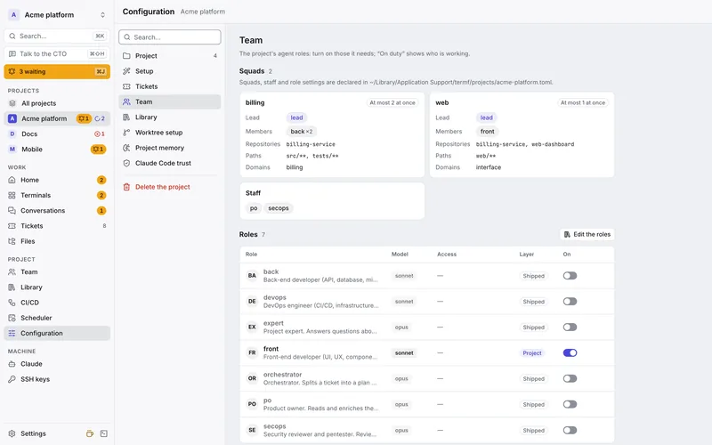

<p align="center">
  
</p>

<h1 align="center">TermF</h1>

<p align="center">
  <b>The cockpit for Claude Code across all your repositories.</b><br>
  Talk to the CTO, and a team of agents takes your tickets to pull requests,<br>
  each run in its own worktree, stopping for your approval at every gate.<br>
  Every Claude Code stays in view, in terminal tabs and splits. Local-first, built with Rust and Tauri.
</p>

<p align="center">
  <a href="https://vassilidev.github.io/TermF/"><b>Website</b></a> ·
  <a href="https://vassilidev.github.io/TermF/download.html"><b>Download</b></a> ·
  <a href="https://github.com/vassilidev/TermF/releases">Releases</a> ·
  <a href="README.fr.md">Version française</a>
</p>

<p align="center">
  <a href="https://github.com/vassilidev/TermF/actions/workflows/ci.yml"></a>
  
  
  
  <a href="LICENSE"></a>
</p>

<picture>
  <source media="(prefers-color-scheme: dark)" srcset="site/shots/home-dark.webp">
  
</picture>

> [!NOTE]
> **Early development.** The builds are unsigned pre-releases. Most of the interface has been checked with automated tests and a simulated backend rather than by hand, and parts of the flow have run with a real Claude Code (a ticket opened in its worktree, a team going from plan to task reports). Expect rough edges, and please [report them](https://github.com/vassilidev/TermF/issues).

## What TermF does

- **Every Claude Code in view.** Sessions in terminal tabs and free splits, Ghostty style (`⌘T`, `⌘D`, `⌘⇧D`, `⌥⌘` + arrows, every shortcut remappable). Each one shows whether it is working, waiting for you or done, read from Claude Code's own hooks, with its context gauge and a notification when it needs you. `⌘J` jumps to the next thing waiting, in any project.
- **One person to talk to: the CTO.** Each project opens on its Home, with a permanent conversation with the CTO agent. Ask for a feature, a fix or where things are: the CTO triages each run, picks its workflow, steps and squads, and acts through TermF's tools, every action behind an approval card. Write `@role` to talk to someone else.
- **A team that takes a ticket to a pull request.** Triage, framing, plan, tasks in parallel, checks, rules, code review, security review, visual review, delivery. The plan comes with a questionnaire and proposed answers; the plan, the visual review and the delivery wait for you. Each step is a fresh agent session with a brief, each run has a budget, and you can take over any conversation in a terminal.
- **Tickets from where they live.** GitHub Issues, GitHub Projects, Jira Cloud and any MCP server, several sources per project. Paste a URL or a key, follow one page per ticket, resume a run after a restart, clean up after the merge.
- **Worktrees that are ready to run.** One per run, inside the repository so Claude Code's trust carries over. The project's recipe installs dependencies without copying them raw, points `.env` files to the worktree, clones the database per worktree (Postgres, MySQL, SQLite) and gives it its own ports.
- **A library that fits your stack.** Roles, rules, skills, workflows and commands in layers (shipped, global, project, repository). 25 roles and 38 skills ship with TermF, and the detected stack turns on the matching ones. The setup assistant reads a new project and proposes its team, skills, ticket sources and worktree recipe, item by item.
- **A project expert with a memory.** A local index of what the project remembers (Claude Code conversations, run logs, library, `CLAUDE.md`, docs, git history), with secrets masked. Ask how something works and get an answer with its sources, in the app or with `termf ask`. The team calls it instead of searching on its own.
- **All of Claude Code in one view.** Settings, permissions, hooks and environment by scope, MCP servers, plugins, skills, agents, commands, output styles, memory files, past sessions, usage and limits, account and version, and a sortable table of your claude.ai artifacts.
- **The chores around the agents.** SSH keys in every format with the agent and `~/.ssh/config`, end-to-end encrypted settings sync across machines, native GitHub Actions runs and logs, a scheduler for Claude tasks (headless ones even while TermF is closed), a vault for secrets (command line for now), and a file explorer with fuzzy search, an editor and diffs.

## Screenshots

<table>
  <tr>
    <td width="50%"><picture><source media="(prefers-color-scheme: dark)" srcset="site/shots/terminals-dark-800.webp"></picture></td>
    <td width="50%"><picture><source media="(prefers-color-scheme: dark)" srcset="site/shots/run-dark-800.webp"></picture></td>
  </tr>
  <tr>
    <td align="center"><sub>Terminals in tabs and splits</sub></td>
    <td align="center"><sub>A ticket's run, with the plan's questions</sub></td>
  </tr>
  <tr>
    <td width="50%"><picture><source media="(prefers-color-scheme: dark)" srcset="site/shots/config-dark-800.webp"></picture></td>
    <td width="50%"><picture><source media="(prefers-color-scheme: dark)" srcset="site/shots/claude-dark-800.webp"></picture></td>
  </tr>
  <tr>
    <td align="center"><sub>A project's team and roles</sub></td>
    <td align="center"><sub>All of Claude Code on this machine</sub></td>
  </tr>
</table>
<p align="center"><sub>Screenshots taken with fictional data: the user alex and the acme repositories.</sub></p>

## Install

Download TermF from [the website](https://vassilidev.github.io/TermF/download.html) or the [releases](https://github.com/vassilidev/TermF/releases):

| System | Files |
|---|---|
| macOS | `TermF_<version>_aarch64.dmg` (Apple Silicon), `TermF_<version>_x64.dmg` (Intel) |
| Windows | `TermF_<version>_x64-setup.exe`, or `TermF_<version>_x64_en-US.msi` |
| Linux (x86_64) | `TermF_<version>_amd64.AppImage`, `.deb` or `.rpm` (needs WebKitGTK 4.1) |

The builds are not signed yet, so the first launch needs one extra step:

- **macOS**: after moving TermF to Applications, run `xattr -dr com.apple.quarantine /Applications/TermF.app` once (or right-click the app, Open, then Open again).
- **Windows**: on the SmartScreen warning, click "More info", then "Run anyway".
- **Linux**: `chmod +x` the AppImage, or install the `.deb` / `.rpm`.

TermF needs [Claude Code](https://code.claude.com) installed and signed in, `git`, and the [GitHub CLI](https://cli.github.com) signed in for GitHub tickets, pull requests and CI/CD.

### Run from source

Prerequisites: Rust (stable), Node 22+, pnpm, and the [Tauri prerequisites](https://tauri.app/start/prerequisites/) for your OS.

```sh
git clone https://github.com/vassilidev/TermF.git
cd TermF/app
pnpm install
pnpm tauri dev
```

`pnpm bundle` builds the installers for your system with the `termf` CLI inside (`pnpm tauri build` alone leaves it out).

### Configuration

On first launch TermF creates `termf.toml` in your config folder (`~/Library/Application Support/termf` on macOS, `~/.config/termf` on Linux, `%APPDATA%\termf` on Windows). By default it scans your home folder for repositories and offers one agent, `claude`; add your own:

```toml
roots = ["~", "D:/dev"]
scan_depth = 5

[agents]
claude = "claude"
codex = "codex"
```

Projects live next to it, in `projects/<id>.toml`. The app writes them for you, and you can edit them by hand:

```toml
name = "Acme"

[[repos]]
path = "~/Projects/acme-api"

[[repos]]
path = "~/Projects/acme-front"
```

## Getting started

1. **Open TermF.** It finds the git repositories on your machine and sorts them by activity.
2. **Create a project** from a few repositories, with the + next to Projects in the navigation. The setup assistant opens once: it reads the repositories without changing anything, asks the questions only you can answer, then proposes the team, skills, ticket sources, worktree recipe and CI, item by item. Trusting the repositories in Claude Code is opt-in.
3. **Talk to the CTO** on the project's Home (`⌘⇧H` from anywhere): "Where is the team at?", "Start the team on #482". Or open Claude Code in a terminal with `⌘T`.
4. **Put the team on a ticket**: ask the CTO, or click With the team next to a ticket in Tickets. Answer the plan's questions, approve the plan, follow the run on its page, then Deliver…: TermF shows the files and commits, and opens the pull request once you confirm.

## The `termf` command line

The CLI ships with the app: inside `TermF.app/Contents/MacOS/termf` on macOS (link it somewhere on your `PATH`), as `/usr/bin/termf` with the `.deb` and `.rpm`, next to the app on Windows. `termf help` lists every command.

| | |
|---|---|
| Sessions | `termf ls`, `termf open <path> [--agent claude]`, `termf say <session> <text>`, `termf watch` |
| Tickets and runs | `termf inbox`, `termf run <ticket>`, `termf runs`, `termf deliver <run>`, `termf close <run>` |
| The team | `termf team run <run>`, `termf team status <run>`, `termf team answer …`, `termf team approve <run> <step>`, `termf team stop` |
| Agents | `termf agent start`, `termf agent send <id> <text>`, `termf agent takeover <id>`, `termf agent handback <id>` |
| The expert | `termf ask <question>`, `termf memory search <query>` |
| Library and config | `termf library ls\|explain\|enable\|disable`, `termf library scout`, `termf config export\|import` |
| Machine | `termf ssh …`, `termf sync …`, `termf vault …`, `termf ci …`, `termf schedule …`, `termf claude …` |

Commands that start a run or a team, approve a gate or answer for you wait for your confirmation in the app.

## Security and privacy

- **Local-first.** No TermF server, no telemetry. Your code goes where Claude Code sends it, to the model, as it would without TermF. The other connections are the ones you set up: GitHub or Jira for tickets, the remote you pick for the sync.
- **A guard on every run.** The `termf guard` hook refuses pushes and tracker writes in a run's sessions and team steps, and a run doesn't start without it. Delivery happens in two steps: a preview, then your confirmation.
- **An isolated local API.** Each agent session gets its own narrow capability on TermF's local API; your token stays out of the agents' reach, and the actions that matter wait for your confirmation in the app.
- **Untrusted input stays data.** A ticket reaches the agent as a framed file marked untrusted. The CTO's conversation reads the repositories but has no shell and no network.
- **Secrets.** `.env` files and private keys are denied to the file tools of the sessions TermF starts. The vault (Argon2id, master password, auto-lock, hash-chained audit) and the settings sync (Argon2id, XChaCha20-Poly1305, recovery key) are encrypted.
- **Honest limits.** These guards are defense in depth on one machine, not an operating system boundary: a process set on getting around them, like a script an agent writes and then runs, still can. The interface has mostly been verified with a simulated backend, and Windows and Linux builds are tested in CI but have not been run by hand. The known gaps are listed in [docs/STATUS.md §4](docs/STATUS.md#4-dettes-et-points-non-vérifiés-connus) (in French).

## Architecture

A Rust core, a Tauri 2 window on the system's webview, and a Svelte 5 interface with xterm.js and CodeMirror. TermF orchestrates the agents itself: a model only plans, and agents talk through TermF (the run's log and its MCP tools), so everything is visible, interruptible and costed.

| | |
|---|---|
| `crates/termf-core` | Config (`termf.toml`, `projects/*.toml`), repository discovery |
| `crates/termf-term` | PTY sessions (portable-pty), ring buffer, attach and replay |
| `crates/termf-agents` | Headless Claude Code sessions over stream-json, taking over and handing back |
| `crates/termf-team` | A run's team: sessions per role, the plan, the workflow engine, gates, budgets, rules |
| `crates/termf-tickets` | Trackers, runs (SQLite, worktrees) and their pull requests |
| `crates/termf-worktree` | Stack-aware worktree setup |
| `crates/termf-library` | The layered library and config export / import |
| `crates/termf-onboarding` | The project setup assistant |
| `crates/termf-memory` | The project memory the expert searches |
| `crates/termf-visual` | Visual review before / after |
| `crates/termf-claude` | Claude Code's config on this machine, claude.ai artifacts |
| `crates/termf-ci`, `termf-schedule` | GitHub Actions, scheduled Claude tasks |
| `crates/termf-ssh`, `termf-sync`, `termf-vault` | SSH keys, encrypted sync, the vault |
| `crates/termf-files` | File explorer, fuzzy finder, search |
| `crates/termf-cli` | The `termf` CLI, Claude Code hooks, the `termf mcp` server |
| `app/src-tauri`, `app/src` | The Tauri host and its IPC commands; the SvelteKit interface |
| `library/` | What ships: roles, rules, skills, workflows, commands |

The reference design is [docs/ARCHITECTURE.md](docs/ARCHITECTURE.md), and what is done is in [docs/STATUS.md](docs/STATUS.md) (both in French).

## Development

```sh
cd app && pnpm tauri dev                      # run the app
cd app && pnpm check && pnpm build            # front end
cd app && pnpm bundle                         # package the app with the termf CLI inside
cargo fmt --all && cargo clippy --workspace --all-targets -- -D warnings && cargo test --workspace
```

The app's clippy and tests need `app/build`: run `pnpm build` first. Interface strings live in `app/src/lib/i18n.ts`, in English and French. The website is in `site/`, published by the Pages workflow.

TermF is meant to be forked and bent to your own way of working. Most customization lives in plain files (settings, roles, rules, workflows, conventions) rather than in code, so a fork can stay small and keep pulling upstream. Contributions are welcome too.

## Roadmap

- Signed and notarized builds, automatic updates, performance budgets and `cargo audit` in CI.
- The vault's interface and secure production access: connections, read-only recipes, approvals.
- Codex and Gemini adapters next to Claude Code.
- More sync remotes (S3, WebDAV), and a global scheduler for every team at work.

The full roadmap is in [ARCHITECTURE.md §17](docs/ARCHITECTURE.md#17-feuille-de-route).

## License

[MIT](LICENSE)
